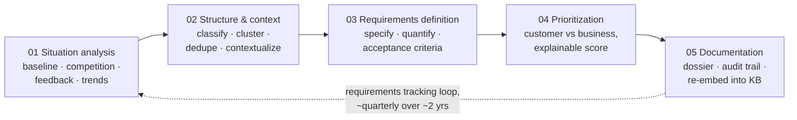

# Overview

> Status: `draft` · Last updated: 2026-10-10

## Mission

Help a BMW product manager derive, justify, and prioritize customer-facing requirements for the
successor of an existing vehicle line — grounded in customer feedback, BMW product/sales data,
and web research — while the PM stays in control of every decision that matters.

## Scope

**In scope:** customer-facing product requirements — features, equipment, comfort, space,
usability, infotainment/digital services, design and quality perception, driving experience,
range and charging *as experienced by the customer*, variant and package offering.

**Out of scope:** regulatory/homologation (safety, emissions, type approval), engineering
specs/architecture/supplier topics, pricing/business-case/cost calculation (cost or effort may be
used as a *rough* prioritization factor only).

A finding that reads as regulatory or pricing in nature is auto-tagged and routed to a visibly
separate "flagged, out of scope" bin rather than drafted into a requirement — see
[`08-scaling-and-config.md`](08-scaling-and-config.md#regulatory-guardrail).

## Demonstration scope

- **Vehicle lines in the provided data:** F70, G60, G70 (presumed 1 / 5 / 7 Series successors —
  confirm before presenting as fact)
- **Markets:** Europe, China, United States, or a subset
- **Demo pick:** G60 (5 Series) × Europe, full vertical slice; other lines/markets loaded and
  runnable on request to prove it isn't a one-off

## The five stages

Taken directly from BMW's own process slide — everything in this doc set is organized around it.

What makes this more than a batch pipeline is **how** a PM moves work from stage to stage — see
[`02-orchestration-and-human-in-the-loop.md`](02-orchestration-and-human-in-the-loop.md): nothing
advances to the next stage without an explicit accept, one agent at a time.

## Document map

See [`../README.md`](../README.md) for the full doc index. Start with
[`01-agents.md`](01-agents.md) for who does what, then
[`02-orchestration-and-human-in-the-loop.md`](02-orchestration-and-human-in-the-loop.md) for how a
PM actually drives this.
