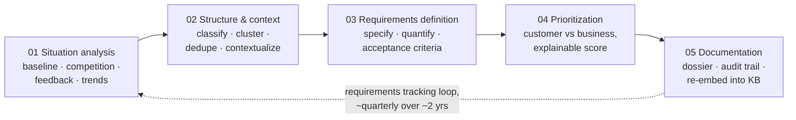

# Overview

> Status: `draft` · Last updated: 2026-10-10 (database workspace; [decision 0023](../decisions/0023-database-backed-workspace.md))

## Mission

Help a BMW product manager derive, justify, and prioritize customer-facing requirements for the
successor of an existing vehicle line — grounded in customer feedback, BMW product/sales data,
and web research — while the PM stays in control of every decision that matters.

## Scope

**In scope:** customer-facing product requirements — features, equipment, comfort, space,
usability, infotainment/digital services, design and quality perception, driving experience,
range and charging *as experienced by the customer*, variant and package offering.

**Out of scope:** regulatory/homologation (safety, emissions, type approval), engineering
specs/architecture/supplier topics, pricing/business-case/cost calculation (cost or effort may be
used as a *rough* prioritization factor only).

A finding that reads as regulatory or pricing in nature is auto-tagged and routed to a visibly
separate "flagged, out of scope" bin rather than drafted into a requirement — see
[`08-scaling-and-config.md`](08-scaling-and-config.md#regulatory-guardrail).

## Scope: set by the question

The system is not tied to one vehicle line or market. Every line in the provided data (F70, G60/G68,
G70; presumed 1 / 5 / 7 Series successors, confirm before presenting as fact) and every market
(Europe, China, United States, Rest of World) is loaded, and a PM can ask in any direction: a
competitor comparison, a feature gap, a market trend, a requirement derivation for one line, a
question across lines. The orchestrator reads the request, picks the agents that are needed, and
the agents search the relevant evidence. Some use models for wording and synthesis; scoring, audit compilation
and Critic provenance checks are deterministic.

Evidence is uneven (some line/market combinations have far more customer feedback than others), so
sample size and confidence are shown with every result rather than hidden by narrowing the scope.

## The five stages

Taken directly from BMW's own process slide — everything in this doc set is organized around it.

What makes this more than a batch pipeline is **how** a PM drives it — see
[`02-orchestration-and-human-in-the-loop.md`](02-orchestration-and-human-in-the-loop.md): the PM
starts a **chat** with a research request, an **orchestrator** plans which agents are needed, and
they run one at a time. Each agent's cited answer can be pushed back on or accepted before the
next agent starts. The PM confirms the plan first; acceptance or explicit rejection with a coverage gap
advances it. The final result appears only once all steps are resolved. Not
every request runs every stage. See [decision 0005](../decisions/0005-chat-entry-and-orchestrator-planned-steps.md).

## Implemented boundary

All frontend views require sign-in and read database evidence or stored agent output through `/api`.
Overview and Reports show recorded sales, catalog/study evidence, accepted contributions and audit events.
Requirements reads persisted backlog rows and scores; missing records stay missing. Runs retain structured
output on steps. Automatic backlog publication, durable recovery, recurring refresh and dossier re-embedding
remain planned.
See [decision 0022](../decisions/0022-project-review-and-live-step-controls.md).

## Document map

See [`../README.md`](../README.md) for the full doc index. Start with
[`01-agents.md`](01-agents.md) for who does what, then
[`02-orchestration-and-human-in-the-loop.md`](02-orchestration-and-human-in-the-loop.md) for how a
PM actually drives this.
