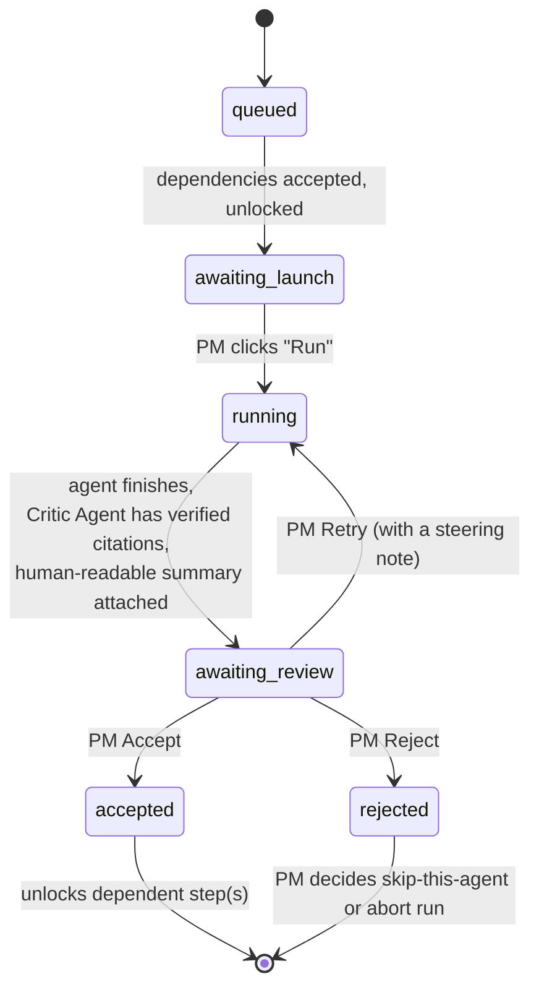
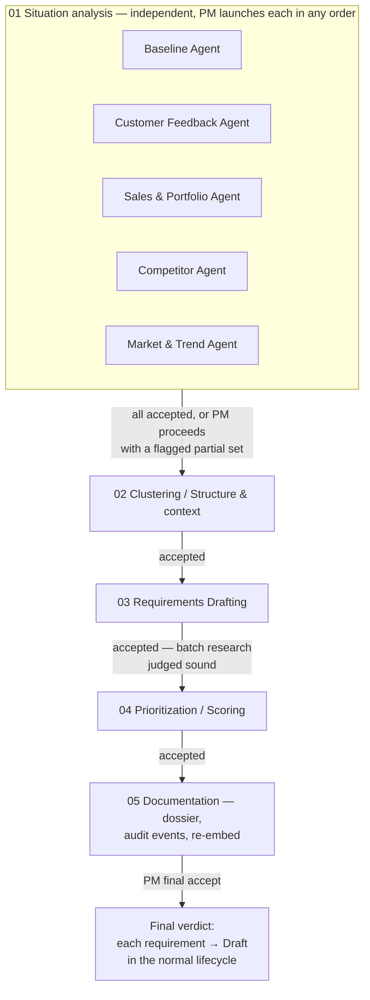

# Orchestration & human-in-the-loop: run one agent at a time, on purpose

> Status: `draft` · Last updated: 2026-10-10

This is the central mechanic of the whole system. Earlier drafts of this architecture gated the PM
in at two points — after a requirement was drafted, and after it was scored. That's not tight
enough: it lets four research agents run unattended, hand their combined output to a synthesizer,
and only then ask the PM "does this look right?" — by which point pushing back on one bad finding
means re-doing all of it.

Instead: **the pipeline doesn't advance to the next agent until the PM has explicitly launched and
accepted the current one.** Every agent run is a reviewable, retryable, rejectable unit on its own.

## The unit of work: a Step

A `PipelineRun` (one end-to-end execution, scoped to a vehicle line + market + trigger) is made of
`Step`s, one per agent invocation. A step only has five states:

Two things are deliberate:

- **`awaiting_launch` is a real, separate state from `running`.** Accepting step N does not
  auto-start step N+1 — it only *unlocks* it. The PM still clicks "Run." This is what "click to
  each agent step by step before it is run" means literally: the PM is the one who starts every
  agent, not just the one who reviews what already ran.
- **The Critic Agent sits inside `running → awaiting_review`**, not after it. A step doesn't reach
  the PM until every claim in its output has a live citation — see
  [`01-agents.md`](01-agents.md#the-critic-agent). The PM pushes back on judgment calls, not on
  obviously unsourced claims; those never arrive.

## The four actions, same verbs as everywhere else

| Action | What it does |
|---|---|
| **Accept** | Step → `accepted`. Its `Finding`/`Cluster`/`Requirement`/`Score` output becomes real input for the next step. Unlocks whatever depends on it. |
| **Edit** | PM directly rewrites the human-readable summary or the underlying structured output (e.g. merges two clusters, tightens a metric) before accepting. The diff is the audit event. |
| **Retry** (= Challenge, at step grain) | PM supplies a steering note ("exclude paywalled sources," "only EU respondents," "re-check that number"). Same agent, same step, re-runs with the note appended to its task. Step goes back to `running`. |
| **Reject** | Step → `rejected`. PM then decides: proceed without this agent's contribution (flagged as a coverage gap on everything downstream) or abort the run. |

This reuses the exact same four verbs as the coarser requirement lifecycle
([`05-requirement-lifecycle.md`](05-requirement-lifecycle.md)) — approve/reject/edit/challenge —
just applied at the grain of one agent's output instead of one finished requirement. The lifecycle
doc is what happens to a requirement *after* a run produces it and the PM gives the final accept;
this doc is how that research got approved in the first place.

## Human-readable output, every time

Every agent emits two things, not one: structured output for the data model, and a short
`StepSummary` — plain language, always including:

- what it looked at (scope, sources, filters applied)
- what it found, as a short bulleted list, each bullet carrying its citation
- how confident it is, and what's thin or missing
- anything it flagged as out of scope (regulatory/pricing) and routed to the side bin

This is what renders in the `awaiting_review` card. It is *not* a separate documentation step
bolted on afterward — it's how the PM reviews anything at all. The Documentation Agent's job at
stage 05 is to compile the already-accepted `StepSummary`s plus the final requirement into one
coherent dossier, not to invent readability from scratch.

## The full chain

Note the last arrow: the "final verdict" of a run is not automatically `Tracked`. It hands each
requirement into the normal [lifecycle](05-requirement-lifecycle.md) at `Draft`, where it can still
be approved, edited, rejected, or challenged individually — a run can produce five candidate
requirements that get decided on five different days by (possibly) five different reviewers.

## Worked example — "what features would we need to stay competitive in the US market?"

1. PM types the question into the run launcher, scoped to `{vehicle_line: G60, market: US}`. A new
   `PipelineRun` is created (`trigger: pm_query`). All five Situation Analysis steps appear as
   `awaiting_launch` cards — nothing has run yet.
2. PM clicks **Run** on the Competitor Agent first (their call — order isn't fixed). It finishes;
   card reads: *"Searched 14 competitor review/spec sources for US midsize sedans. 6 findings: 3
   competitor_advantage, 2 market_trend, 1 unmet_need. 2 sources are paywalled — flagged
   Interpreted."*
3. PM clicks **Retry**: *"drop the paywalled ones, find a free equivalent or mark unverified."*
   Same agent re-runs. PM reviews again, clicks **Accept**.
4. PM clicks **Run** on Customer Feedback Agent (US-filtered), Sales & Portfolio Agent, and
   Market & Trend Agent in turn — three more independent click → review → accept cycles. Accepting
   one does not start the next; the PM clicks each one.
5. All five accepted → Clustering unlocks. PM runs it, **Edits** one cluster (two themes were
   really the same complaint), **Accepts**.
6. Requirements Drafting unlocks. PM runs it, reviews the drafted requirements as a batch, judges
   the research sound, **Accepts** — each draft now exists independently in the normal lifecycle.
7. Prioritization unlocks. PM reviews the score breakdown, nudges `business_signal` weight up for
   this program, re-runs, **Accepts**.
8. Documentation unlocks, compiles the dossier, writes every `AuditEvent` for the run, re-embeds it
   into the knowledge layer. PM gives the final accept.

End state: a cited, ranked shortlist of candidate requirements sitting in the normal backlog at
`Draft`, and an audit trail (see [`07-audit-trail.md`](07-audit-trail.md)) that shows exactly which
agent ran when, what the PM retried and why, and what was accepted verbatim versus edited — not
just a final answer with no visible work.

## Data model additions

Two entities this doc introduces; full schema in
[`04-data-model.md`](04-data-model.md#pipelinerun--step): `PipelineRun` (the scope + trigger of one
execution) and `Step` (one agent's slot in it, with its state, its `StepSummary`, and who
launched/accepted/retried/rejected it and why).

## UI shape

A run view is a vertical stepper, one card per step, grouped by stage — not a single "run
everything" button. A card's only possible actions are determined by its state: `awaiting_launch`
shows **Run**; `awaiting_review` shows the `StepSummary` plus **Accept / Edit / Retry / Reject**;
anything else is read-only history. This is deliberately closer to a CI pipeline with manual
approval gates than to a chatbot — the PM is operating the system, not just chatting with it.
