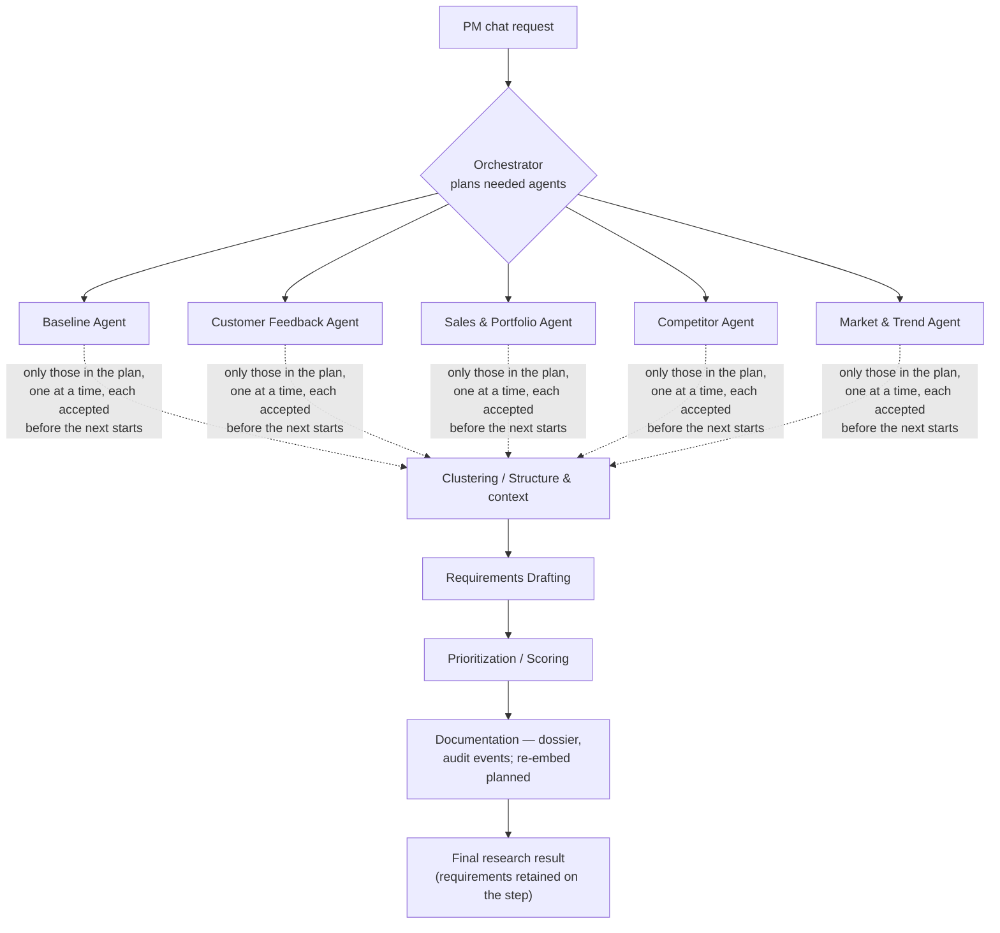

# Orchestration & human-in-the-loop: a chat that plans, then runs one agent at a time

> Status: `building` · Last updated: 2026-10-10 (database workspace; [decision 0023](../decisions/0023-database-backed-workspace.md))

This is the central mechanic of the whole system. The PM starts a **chat** with a research request.
An **orchestrator** decides which agents are needed. They run **one at a time**, and each agent's
answer is shown in the chat for the PM to push back on or accept **before the next agent starts**.
Nothing is shown as a final result until every planned step has been accepted or explicitly rejected with
permission to continue. Rejections remain visible coverage gaps.

Earlier drafts gated the PM at the end only, then at every step but with a manual "Run" click per
agent. The chat model keeps the per-step gate and removes the extra click: **accepting a step is
what starts the next one.**

## Entry point: a chat

1. PM opens a **new chat** and types a research request, e.g. *"What would we need to stay
   competitive on seat comfort in the US market?"* Scope (vehicle line, market) is taken from the
   message; an omitted line or market means `ALL`. The plan shows the resolved scope before confirmation.
2. The **Orchestrator** reads the request and produces a **plan**: the ordered list of agents
   needed and why each is included (e.g. Customer Feedback → Competitor → Clustering →
   Requirements Drafting; Baseline and Market/Trend left out, with the reason). The plan is shown
   in the chat. The PM can edit it (add or remove agents; order follows the catalog) before the first agent starts.
3. The PM confirms the plan with **Start research**. The first agent starts. When it finishes, its answer
   appears as a step card in the chat.
4. The PM pushes back or accepts. On **Accept**, the orchestrator starts the next needed agent
   automatically, with the accepted output as context. The plan is locked once execution starts;
   adapting it mid-run remains planned.
5. After the last step is accepted or explicitly skipped, the **final research result** is compiled and shown with
   citations. It is not shown earlier.

Not every request needs every agent. A question that only needs feedback evidence runs two or three
agents; a full requirement derivation runs the whole chain.

## How the plan is made (implemented)

`POST /api/conversations/{id}/messages` stores the PM's request, asks the planner for a plan, and stores it as a
`plan` message plus one `planned` step per agent. Nothing runs yet.

- **The model proposes, code decides.** An OpenAI model picks agents from the catalog (`orchestration/catalog.py`)
  with a one-sentence reason each and extracts the scope if the request states one. Code then drops unknown agents,
  removes duplicates, orders by pipeline stage, and adds the prerequisites a later stage needs (Prioritization needs
  Drafting, Clustering and a research agent). Added prerequisites are marked as such.
- **Scope is optional.** No line or market in the request means all of them (stored as `ALL`).
- **Agents that are not built are still planned**, flagged `[not built yet]`, with a note in the thread, so the PM
  sees what the question really needs. They cannot run until they exist and can be removed from the plan.
- **No hidden fallback.** If the model is unavailable the API answers 503 with the reason and stores nothing.
  `PLANNER=rules` selects a keyword planner for local work without a key.
- **The PM can edit the plan** (`PUT /api/runs/{id}/plan`) until an agent has started. An edit is checked, never
  silently completed: removing a prerequisite is refused with the reason. Each edit adds a `plan_change` message.
- Plans and edits are written to the audit log (`plan_created`, `plan_edited`).

## How a plan runs (implemented)

`orchestration/runner.py` applies the state machine below; `orchestration/agents.py` holds one adapter per agent.

| Call | Effect |
|---|---|
| `POST /api/runs/{id}/start` | The PM confirms the plan. The first step goes to `running` and the plan is locked |
| `POST /api/steps/{id}/accept` `{note}` | Step → `accepted`; the next planned step starts, or the run completes with a `final_result` message |
| `POST /api/steps/{id}/retry` `{note}` | Same step back to `running` with the steering note; `attempt` + 1 |
| `POST /api/steps/{id}/reject` `{note, proceed}` | Step → `rejected`; `proceed` true goes on with a coverage gap, false aborts the run |
| `POST /api/steps/{id}/edit` `{summary}` | Rewrites the summary; the step stays in review |

- **The agent runs after the response.** The call returns with the step `running`; the step card arrives in the
  thread when the agent and the Critic are done, so the client polls `GET /api/conversations/{id}`.
- **The Critic is inside every run**, with one automatic retry. Claims that stay uncited are dropped and listed on
  the card. Synthesis steps are checked against the findings accepted earlier in the run.
- **Finding ids include source and scope** as well as locator and text, avoiding collisions between identical
  spreadsheet rows in different files.
- **Output lives on the step** as JSON (`structured_output_refs`) and in the step card's payload. The next agent
  receives only the output of accepted steps. Nothing is written to the finding, cluster, requirement or score
  tables by a run yet.
- **A failed agent** ends in `awaiting_review` with no output and a failure card. It can be retried or
  rejected, but cannot be accepted, even after editing its summary.
- **Review reasons** are required for acceptance, retry and rejection (at least three non-whitespace
  characters). Plan confirmation records a `run_started` event with the signed-in PM as actor.
- **An action outside its state is refused** with 409 and the reason (accepting a planned step, starting twice,
  acting on a finished run).
- Every start, finish, accept, edit, retry and reject is an audit event on the step.

## The unit of work: a Step

A `PipelineRun` (one chat request's execution, scoped to a vehicle line + market) is made of
`Step`s, one per agent invocation. A step has five states:

```mermaid
stateDiagram-v2
    [*] --> planned: orchestrator adds it to the plan
    planned --> running: PM confirms first step;<br/>previous step accepted or explicitly skipped
    running --> awaiting_review: agent finishes,<br/>Critic checked provenance,<br/>human-readable summary attached
    awaiting_review --> accepted: PM Accept
    awaiting_review --> running: PM Retry (steering note in chat)
    awaiting_review --> rejected: PM Reject
    accepted --> [*]: starts the next needed step
    rejected --> [*]: PM decides skip-this-agent or abort run
```

Deliberate points:

- **Review gates every advance.** Acceptance starts the next step. Rejecting with `proceed=true` also
  advances, explicitly excluding that output. The first step starts only after plan confirmation.
- **The Critic Agent sits inside `running → awaiting_review`**, not after it. A step doesn't reach
  the PM until its supported claims pass provenance checks or unsupported items are dropped — see
  [`01-agents.md`](01-agents.md#the-critic-agent). This checks locators and known finding references;
  it does not fetch every source or prove semantic truth. The PM still reviews the evidence.
- **One agent at a time is enforced by the database,** not only by the app: a unique index allows at most one step
  per run in `running` or `awaiting_review`.
- **Plan changes are allowed before execution only.** Already accepted steps are never silently re-run.
  Mid-run adaptation remains planned.

## The four actions, same verbs as everywhere else

| Action | What it does |
|---|---|
| **Accept** | Step → `accepted`. Its `Finding`/`Cluster`/`Requirement`/`Score` output becomes real input for the next step, and the orchestrator starts that step. |
| **Edit** | PM rewrites the human-readable summary before accepting. Structured findings, clusters, metrics and scores are not changed by this action. The diff is the audit event. |
| **Retry** (= Challenge, at step grain) | PM replies in the chat with a steering note ("exclude paywalled sources," "only EU respondents," "re-check that number"). Same agent, same step, re-runs with the note appended to its task. Step goes back to `running`. |
| **Reject** | Step → `rejected`. PM then decides: proceed without this agent's contribution (flagged as a coverage gap on everything downstream) or abort the run. |

Pushing back is a normal chat message on the step's thread, so the conversation reads as a dialogue
with the system rather than a form.

This reuses the exact same four verbs as the coarser requirement lifecycle
([`05-requirement-lifecycle.md`](05-requirement-lifecycle.md)) — approve/reject/edit/challenge —
just applied at the grain of one agent's output instead of one finished requirement.

## Human-readable output, every time

Every agent emits two things, not one: structured output for the data model, and a short
`StepSummary` — plain language, always including:

- what it looked at (scope, sources, filters applied)
- what it found, as a short bulleted list, **each bullet carrying its citation** (source +
  locator: file and page/sheet/row, or URL and retrieval date)
- how confident it is, and what's thin or missing
- anything it flagged as out of scope (regulatory/pricing) and routed to the side bin

This is what renders in the chat as the step card. The final research result is compiled from the
accepted `StepSummary`s; every statement in it can only cite findings that were retrieved and
accepted along the way.

## The full chain

Which of these appear in a given run is the orchestrator's decision. A pure market-research question
may stop after the research agents and Clustering; Drafting, Prioritization, and Documentation are
added according to the validated plan. Draft requirements remain JSON on the step. Persisting
accepted drafts into the backlog and the normal [lifecycle](05-requirement-lifecycle.md) is pending.

## Worked example — "what features would we need to stay competitive in the US market?"

This example is illustrative; source counts are not measured live results.

1. PM starts a new chat with that question. Orchestrator replies with a plan: *Customer Feedback (US) →
   Competitor → Market & Trend → Clustering → Requirements Drafting → Prioritization.
   Skipping Baseline (no previous-generation angle asked for).* PM adds Sales & Portfolio before
   Clustering and confirms.
2. Customer Feedback starts and is reviewed, then Sales & Portfolio. Once both are accepted, Competitor
   starts. Card: *"Searched 14 competitor review/spec sources for US midsize
   sedans. 6 findings: 3 competitor_advantage, 2 market_trend, 1 unmet_need. 2 sources are
   paywalled — flagged Interpreted."* Each finding has its URL and retrieval date.
3. PM replies **Retry**: *"drop the paywalled ones, find a free equivalent or mark unverified."*
   Same agent re-runs. PM reviews again and clicks **Accept**.
4. Market & Trend starts automatically after Competitor is accepted, using the requested scope. Each agent
   starts only after the previous review is resolved.
5. Clustering starts. PM **Edits** the summary to clarify a theme, then
   **Accepts**.
6. Requirements Drafting starts, then Prioritization. PM reviews the score breakdown, nudges the
   `business_signal` weight, re-runs, **Accepts**.
7. Last agent accepted: the final research result appears in the chat, with a citation on every
   supported claim. Draft requirements remain on the step; backlog persistence is pending. Every launch,
retry, edit, and
   accept is in the audit trail (see [`07-audit-trail.md`](07-audit-trail.md)).

## Data model additions

`PipelineRun` and `Step` (full schema in [`04-data-model.md`](04-data-model.md#pipelinerun--step)),
plus `Conversation` and `Message` for the chat thread: a run belongs to one conversation, step
cards and PM replies are messages linked to their step.

## UI shape

A chat thread. The user's request, the orchestrator's plan, each step card, and the PM's pushback
replies are all messages in order. A step card in `awaiting_review` shows the `StepSummary` with
citations plus **Accept / Edit / Retry / Reject**; anything else is read-only history. A plan strip
at the top shows which steps are planned, running, or done. It's closer to a CI pipeline with
manual approval gates, driven through a chat, than to a chatbot that answers in one go — the PM is
operating the system, not just chatting with it.

## Delivered frontend

The only Research flow uses the authenticated backend planner and runner. It displays the actual plan,
lets the PM edit it before launch, starts agents after confirmation and polls running steps. Accept,
Edit summary, Retry and Reject call backend endpoints; rejection requires an explicit continue-with-gap
or abort choice. Only the newest card is actionable and failed outputs cannot be accepted.

Overview and Reports read accepted step contributions from the database, alongside persisted evidence
and audit events. Requirements reads existing backlog rows and scores. Acceptance does not automatically
publish step JSON into backlog tables. The fixed three-step fixture walkthrough and local browser
business state were removed. There is no LangGraph checkpointer. See
[decision 0023](../decisions/0023-database-backed-workspace.md) and the
[frontend guide](../../frontend/README.md).
