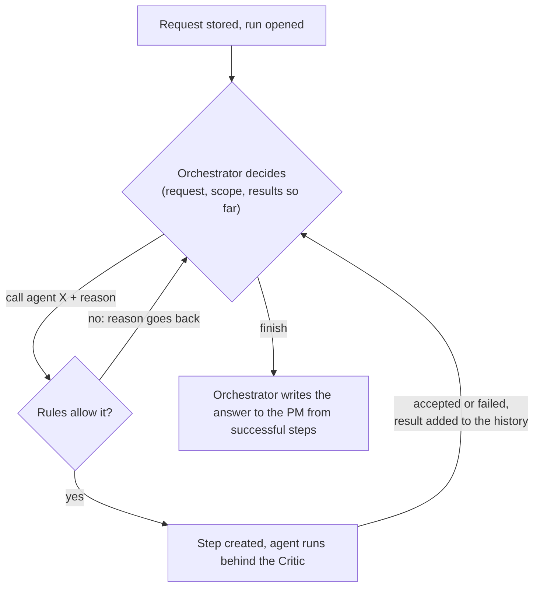
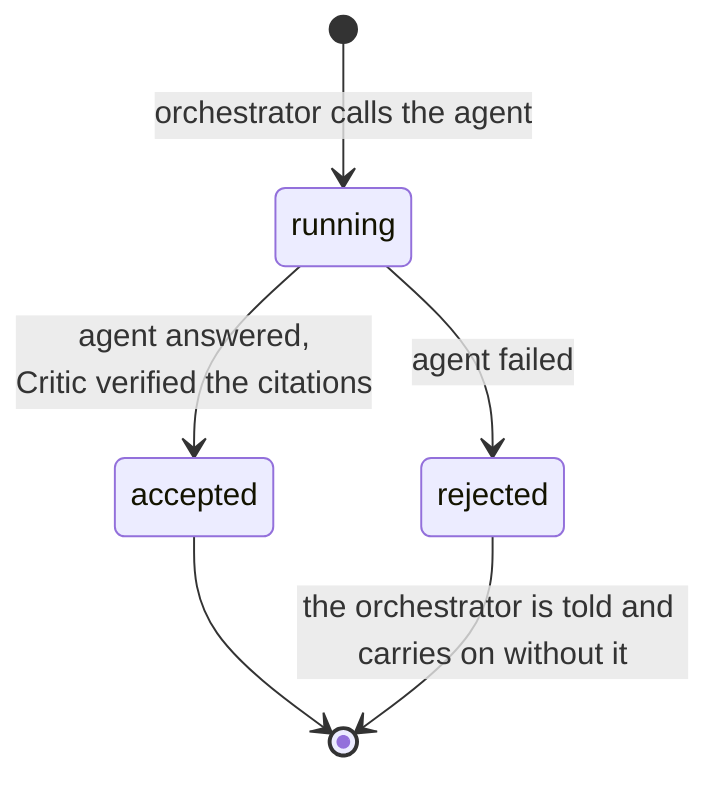
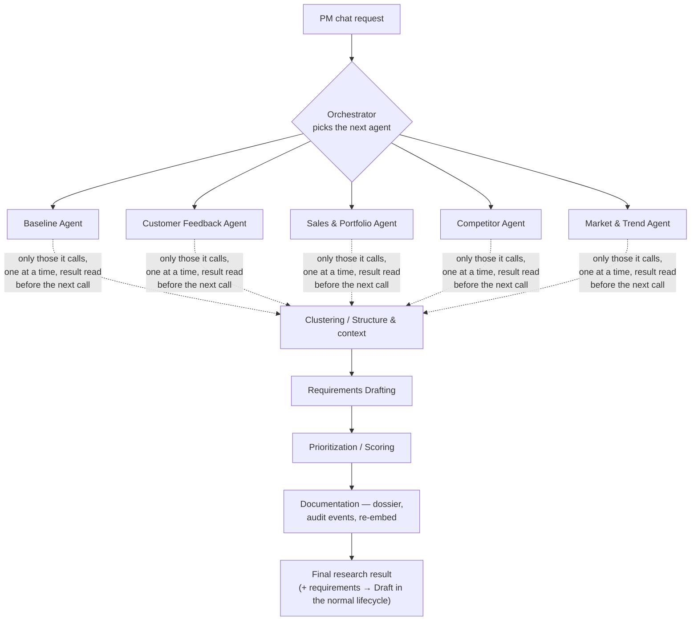

# Orchestration: an orchestrator that decides which agents to call, in a loop

> Status: `building` · Last updated: 2026-10-11 (the orchestrator writes the final answer, [decision 0023](../decisions/0023-orchestrator-writes-the-final-answer.md); LangGraph graph with a Postgres checkpointer; see [decisions 0018](../decisions/0018-orchestrator-decides-in-an-agentic-loop.md) and [0019](../decisions/0019-orchestration-loop-runs-on-langgraph.md))

This is the central mechanic of the whole system. The PM starts a **chat** with a research request.
An **orchestrator** works on it alone: it chooses an agent, reads that agent's answer, and decides
whether it needs another agent on top of it. When it has enough, it finishes and the final result is
shown. The PM does not choose agents, start anything or approve steps. The file name keeps its old
"human-in-the-loop" wording so links keep working; the human is no longer in the loop.

History: decision 0002 gated the PM at every step, 0005 added a chat and an up-front plan, and 0018
replaced both with this loop because the PM was doing the orchestrator's job.

## Entry point: a chat

1. PM opens a **new chat** and types a research request, e.g. *"What would we need to stay
   competitive on seat comfort in the US market?"*
2. The backend stores the request and reads its scope (vehicle line and market, or all). The request
   is answered at once; the work continues in the background.
3. The orchestrator loop starts (below). Each decision and each agent result appears in the thread as
   it happens, and the client polls `GET /api/conversations/{id}` until the run ends.
4. The **final research result** is compiled from the successful steps, with citations, and a follow-up
   request can be sent. One request at a time runs per conversation.

## The loop (implemented)

`orchestration/loop.py` is a LangGraph graph with the nodes below; `orchestration/orchestrator.py` holds the decision-maker.
The nodes are `decide`, `validate`, `run_agent` and `finish`.

- **The model proposes, code decides.** The orchestrator model is shown the agent catalog, the request, the scope
  and, for every agent already called, its summary, finding count and whether it succeeded. It answers with one
  JSON decision: `call` an agent with a reason, or `finish`. `check_call` refuses an unknown agent, one not built,
  one that already ran in this request, and a later-stage agent whose earlier stages have no successful result
  (Clustering needs a stage 1 result, Drafting needs Clustering, and so on). A refusal is sent back to the model;
  more than two in a row end the run with what it has.
- **It reacts to results.** A request about what customers say may stop after one agent; a thin or failed answer
  can lead to a second research agent; a request for requirements goes on to Clustering, Drafting and so on.
- **Budget.** At most 8 agent calls per request. Each is a model and possibly a web call.
- **No hidden fallback.** If the model is unavailable before any agent ran, the run aborts and the thread says why.
  If it fails after some agents succeeded, the run completes with what they found and says so. `ORCHESTRATOR=rules`
  selects a keyword stand-in for tests and local work without a key; it does not react to results.
- **A request that needs no agent** (not about vehicles or the market) gets a note and an aborted run.
- **One agent at a time** is enforced by the database: a unique index allows at most one step per run in `running`.
- **Runs survive a restart.** The graph is checkpointed in Postgres (thread id = run id; tables from migration
  `20261014_langgraph_checkpoints.sql`). The graph state is control flow only; the history the orchestrator reads is
  rebuilt from the step and message tables. When the API starts it continues every run left `in_progress` that has a
  checkpoint. A step that was `running` when the process died runs its agent again in the same step; an agent that
  already finished is never called again. A session advisory lock per run stops two processes driving the same run.

## The unit of work: a Step

A `PipelineRun` (one request's execution, scoped to a vehicle line and market) is made of `Step`s, one per agent
call. A step is created when the orchestrator decides, with the reason in `plan_reason`:

- **The Critic Agent sits inside `running`**, one automatic retry. Claims that stay uncited are dropped and listed on
  the card. Synthesis steps are checked against the findings of earlier successful steps. See
  [`01-agents.md`](01-agents.md#the-critic-agent). With no person reviewing, this is the only review, so the
  orchestrator and the final result only ever see what survived it.
- **Output lives on the step** as JSON (`structured_output_refs`) and in the step card's payload. A later agent
  receives only the output of accepted steps; a failed step contributes nothing and is named as a coverage gap in
  the final result. Nothing is written to the finding, cluster, requirement or score tables by a run yet.
- **A failed agent** ends the step `rejected` with the reason on it; the orchestrator sees that and may call a
  different agent for the same ground.
- A step is never re-run, and an agent is called at most once per request.
- Every decision and outcome is an audit event (`run_started`, `step_started` with the reason, `step_finished` or
  `step_failed`, `run_completed` or `run_aborted`), actor `orchestrator`; the requester is recorded on `run_started`.

## Human-readable output, every time

Every agent emits two things, not one: structured output for the data model, and a short
`StepSummary` — plain language, always including:

- what it looked at (scope, sources, filters applied)
- what it found, as a short bulleted list, **each bullet carrying its citation** (source +
  locator: file and page/sheet/row, or URL and retrieval date)
- how confident it is, and what's thin or missing
- anything it flagged as out of scope (regulatory/pricing) and routed to the side bin

This is what renders in the chat as the step card, and what the orchestrator reads before choosing its next call.
The final research result is compiled from the successful `StepSummary`s; every statement in it can only cite
findings that were retrieved and passed the Critic along the way.

## The chain (what the orchestrator chooses from)

Which of these appear in a given run is the orchestrator's decision. A pure market-research question
may stop after the research agents; Clustering, Drafting, Prioritization and Documentation are
added only when the request asks for requirements. When requirements are produced, each enters the
normal [lifecycle](05-requirement-lifecycle.md) at `Draft` and can still be approved, edited,
rejected, or challenged individually, so human approval still exists at the requirement level.

## Worked example — "what features would we need to stay competitive in the US market?"

1. PM sends the question. The orchestrator reads it as G60-agnostic, US, and calls the **Competitor Agent**:
   *"asks what rivals offer."*
2. The card arrives: *"Searched 14 sources. 6 findings; 2 paywalled sources flagged Interpreted."* The orchestrator
   reads it and calls the **Customer Feedback Agent** (US): *"check whether the rival features match what owners ask for."*
3. It reads that result too, decides the market direction matters, and calls **Market & Trend**.
4. The request asked what features are needed, so it calls **Clustering**, then **Requirements Drafting**. It does not
   call Baseline (no previous-generation angle) or Prioritization (no ranking asked for), and finishes.
5. The final result appears with a citation on every claim; the draft requirements sit in the backlog at `Draft`.
   Every decision and result is in the audit trail (see [`07-audit-trail.md`](07-audit-trail.md)).

## Data model additions

`PipelineRun` and `Step` (full schema in [`04-data-model.md`](04-data-model.md#pipelinerun--step)),
plus `Conversation` and `Message` for the chat thread: a run belongs to one conversation, the orchestrator's decisions
are `system_note` messages carrying `payload.decision`, and agent results are `step_card` messages linked to their step.

## Not built

- A separate worker or queue: a run executes in the API process. A restart resumes it, but an agent that was mid-call repeats that call.
- Parallel stage 1 agents (LangGraph's `Send`); the orchestrator returns one call at a time.
- Steering by the PM mid-run. A follow-up request starts a new run once the last one ended.

## Delivered frontend

`frontend/` shows the thread read-only: the request, the orchestrator's decisions with reasons, each agent's cited
result, and the final result. It shows who is working while a run is in progress and refreshes until it ends. There
are no plan, start or review controls. See the [frontend guide](../../frontend/README.md).
