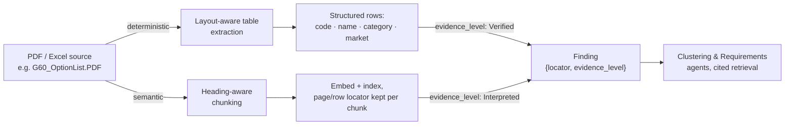

# Ingestion: turning a PDF or spreadsheet into a cited Finding

> Status: `draft` · Last updated: 2026-10-10

The provided PDFs (`F70_OptionList.PDF`, `G60_OptionList.PDF`, `G70_OptionList.PDF`) are
structured option/equipment listings, not prose. Treating them as plain text to embed would throw
away exactly the structure that makes them useful, and would make every citation vague ("chunk
47"). Instead, every source is parsed on two tracks at once, and both converge on the same thing: a
`Finding` with a precise locator and an honest `evidence_level`.

## Tier 1 — deterministic (tables)

Pure ETL, no model in the loop: option code, name, category, market availability parsed straight
into a relational `Options` table. High trust by construction — `evidence_level = Verified`. Feeds
the Sales & Portfolio Agent directly, so qualitative feedback can be cross-checked against what
customers actually paid for.

## Tier 2 — semantic (narrative text, web content)

Any narrative text — in a PDF, in a web source the Competitor/Market Agents pull — is chunked by
heading, not by fixed token count, embedded, and indexed with its page/section locator kept on
every chunk. Retrieval is always cited back to that locator. `evidence_level = Interpreted` by
default; the Critic Agent (see [`01-agents.md`](01-agents.md#the-critic-agent)) can downgrade it
further if the citation is thin.

For web sources specifically, `evidence_level` is instead set by source-trust tier — OEM/official
> trade press/reviews > forum/social — rather than by extraction method. Either grading can be
overridden by the PM on a specific finding (see
[`02-orchestration-and-human-in-the-loop.md`](02-orchestration-and-human-in-the-loop.md)); the
override is logged and feeds back into how that source is graded next time.

## Excel sources

`*_feedback_hackathon.xlsx`, `*_customer_studies.xlsx`, `sales_volumes.xlsx` are tabular already —
no extraction-tier split needed, but the same locator discipline applies: every `Finding` pulled
from a spreadsheet carries the sheet name, row, and column it came from, not just "from the
feedback file."
