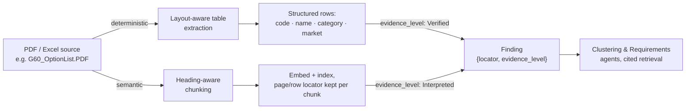

# Ingestion: turning a PDF or spreadsheet into a cited Finding

> Status: `draft` · Last updated: 2026-10-10 (websites as sources, see [decision 0024](../decisions/0024-websites-as-sources-and-tabbed-sources-view.md))

The provided PDFs (`F70_OptionList.PDF`, `G60_OptionList.PDF`, `G70_OptionList.PDF`) are
structured option/equipment listings, not prose. Treating them as plain text to embed would throw
away exactly the structure that makes them useful, and would make every citation vague ("chunk
47"). Instead, every source is parsed on two tracks at once, and both converge on the same thing: a
`Finding` with a precise locator and an honest `evidence_level`.

## Tier 1 — deterministic (tables)

Pure ETL, no model in the loop: option code, name, category, market availability parsed straight
into a relational `Options` table. High trust by construction — `evidence_level = Verified`. Feeds
the Sales & Portfolio Agent directly, so qualitative feedback can be cross-checked against what
customers actually paid for.

## Tier 2 — semantic (narrative text, web content)

Any narrative text — in a PDF, in a web source the Competitor/Market Agents pull — is chunked by
heading, not by fixed token count, embedded (OpenAI `text-embedding-3-small`, stored in `chunk.embedding` in Supabase), and indexed with
its page/section locator kept on every chunk. Retrieval is always cited back to that locator. `evidence_level = Interpreted` by
default; the Critic Agent (see [`01-agents.md`](01-agents.md#the-critic-agent)) can downgrade it
further if the citation is thin.

For web sources specifically, `evidence_level` is instead set by source-trust tier — OEM/official
> trade press/reviews > forum/social — rather than by extraction method. Either grading can be
overridden by the PM on a specific finding (see
[`02-orchestration-and-human-in-the-loop.md`](02-orchestration-and-human-in-the-loop.md)); the
override is logged and feeds back into how that source is graded next time.

Web sources are currently found by the LLM's built-in web search tool, not a separate search API
(see [decision 0009](../decisions/0009-web-search-through-the-llm.md)). Each cited URL becomes a
`source` row (`type = web`, trust tier, `retrieved_at`), and findings are extracted from it like
from any other source. The page itself is not fetched, so there are no chunks for web sources and
the stored snapshot is the model's cited summary of the page.

## Excel sources

`*_feedback_hackathon.xlsx`, `*_customer_studies.xlsx`, `sales_volumes.xlsx` are tabular already —
no extraction-tier split needed, but the same locator discipline applies: every `Finding` pulled
from a spreadsheet carries the sheet name, row, and column it came from, not just "from the
feedback file."

## As implemented (decision 0006)

Scripts live in `backend/app/ingest/` (run as `python -m app.ingest.<module>`); raw files stay in the gitignored `data/` folder. Both loaders are
idempotent (re-running replaces a file's rows) and need `OPENAI_API_KEY` and `SUPABASE_DB_URL` in `.env`.

### PDFs → `source` + `chunk` (`app/ingest/load_pdfs.py`, `app/ingest/pdf_chunks.py`)

- The three `*_OptionList.PDF` files are **German sales catalogs** (e.g. "BMW 5er Limousine Katalog
  Juli 2026", 23–28 pages), not clean option lists. They contain real selectable text, so no OCR.
- Text is extracted page by page with `pdftotext -layout`, split at ALL-CAPS headings, and capped
  at ~1,800 characters per chunk; fragments under 250 characters are merged into a neighbour on the
  same page. 149 chunks in total (F70 39, G60 58, G70 52).
- Each `chunk` keeps `page`, `chunk_index`, `heading`, and the verbatim text; the embedding input
  is prefixed with the catalog title, page, and heading for better retrieval.
- Embedded with OpenAI `text-embedding-3-small` (1536 dims).
- `public.match_chunks()` does cosine search; `app/ingest/ask_pdf.py` answers questions. **Citations are
  built from the retrieved rows** (file, page, verbatim quote), never from model output.

Known limit: flattened chunk text cannot tie a ■/□ mark to a model variant, so the answer prompt
forbids such claims; use the Tier 1 tables below for availability. Prices appear in the catalogs
but are out of scope for requirements.

### PDFs → `option` + `option_availability` (Tier 1: `app/ingest/pdf_options.py`, `app/ingest/load_options.py`)

The equipment pages are parsed by **position** with pdfplumber, not as text: the SA code, gross
price and bracketed net price sit at fixed x positions (found per page from the rotated
"SA-Nr." / "EUR inkl." headers), and each ■ (standard) / □ (optional) mark sits under a variant
column. The variant names are printed rotated 90° in the page header; they are decoded and matched
to marks by x position.

- 198 options (F70 53, G60 62, G70 83), 1,352 availability rows (one per option × price line ×
  variant). An option can have several price lines (different price per variant group), each with
  its own condition text such as "In Verbindung mit M Sportpaket".
- Code-only options directly under a priced one (e.g. paint colours) share its price and marks and are
  flagged `inherited`.
- **Completeness check:** every ■/□ on the equipment pages is captured exactly once (F70 260,
  G60 541, G70 305), and the three catalogs' variant names decode (G60 10, F70 6, G70 4).
- Not covered: the "selected standard equipment" pages (no SA codes), the package description pages
  (M Sportpaket etc.), and the technical-value pages. They remain searchable as chunks.

### Excel → relational tables (`app/ingest/load_excel.py`)

| File | Table | Rows | Notes |
|---|---|---|---|
| `F70/G60/G70_feedback_hackathon.xlsx` | `feedback_raw` | 13,771 | One row per comment with all 12 original columns (`ext_id`, `country`, `engine_type`, `feedback_type`, `comment`, `vfc_label`, `vfc_level2/3`, …) plus sheet and row. Comment embedded. |
| `sales_volumes.xlsx` | `sales_volume` | 36 | Sheet (F70, G60_G68, G70) × market × year; 2030 flagged `is_forecast`. |
| `F70_G60_G68_G70_customer_studies.xlsx` | `study_response` | 1,627 | Cross-tabs unpacked to rows: China/EU sheet → `mean` per model; US sheet → answer `share` per model. Cell reference kept. No respondent counts exist in the file. |

`public.match_feedback()` does cosine search over comments with optional vehicle-line and country
filters. Counts, sample sizes and uptake come from SQL on these tables; only comments and PDF text
are searched by meaning. `finding` rows are **not yet derived** from `feedback_raw` (that is the
Customer Feedback Agent's job).

### Uploads (`app/ingest/upload.py`, `POST /api/sources`, decision 0023)

A signed-in PM adds a file in the Sources view. The file goes to `POST /api/sources` as the raw request body and is
stored by the loaders above, so an uploaded file and a provided file end up in the same tables with the same
citations.

| Upload | Recognised by | Stored as |
|---|---|---|
| PDF | extension and file signature | `chunk` (always); `option` + `option_availability` when the catalog's equipment tables are found and a vehicle line is given |
| Feedback export `.xlsx` | 12 header columns, an ID in the first column | `feedback_raw`, comments embedded |
| Sales volumes `.xlsx` | a market code (`EU`, `CN`, `US`, `RoW`) and a number in the first rows; one sheet per vehicle line | `sales_volume`; years are read from the header |
| Customer studies `.xlsx` | sheet names starting `CN_EU` or `US_` | `study_response` |

- Each loader **normalizes the rows it loads** (vehicle line, market, domain, polarity, powertrain, model variant),
  with the rules of the knowledge-layer migration. Search filters and the coverage table see an upload at once.
- The answer is the **ingest report**: what was stored, and what was skipped and why (rows without an ID, cells
  without a number, comments whose country maps to no market, equipment options found without a vehicle line).
- A file name that is already loaded is refused unless sent as a replacement, which replaces that file's rows.
  Rows that findings already cite cannot be replaced.
- Refused with a reason: other file types, a spreadsheet in an unknown layout, a PDF without selectable text
  (scanned), files over 25 MB. Not built: column mapping for unknown spreadsheets (`FR-IN-09`), Word and pasted
  text (`FR-IN-10`), and recording who uploaded a file (`FR-IN-02`).

### Websites (`app/ingest/load_web.py`, `POST /api/sources/web`, decision 0024)

A signed-in PM adds a web address in the Sources view, or stores a page a web agent has read. The backend fetches
that one page and stores it the way a PDF is stored.

| Step | What happens |
|---|---|
| Address | http(s) only, no credentials, at most 2,000 characters. The fragment is dropped; the rest is the source's identity (`source.uri`). |
| Fetch | Each address, redirects included, must resolve to a public IP. At most 5 redirects, 15 seconds, 3 MB. HTML and plain text only. |
| Text | Scripts, styles, navigation, headers, footers, asides and forms are left out. `h1` to `h3` become the passage heading. |
| Passages | Blocks under one heading are joined up to 1,800 characters; a long block is cut at a sentence end. At most 150 per page. |
| Store | `source` (type `web`, trust tier, optional vehicle line and market) and one embedded `chunk` per passage, `page` = its position. |

- A passage is cited as `page N` and found by Evidence search and the agents through `evidence_item`, as kind
  `pdf_text`. The source viewer shows it with the passage before and after, and links to the page.
- The trust tier is the PM's choice, or the one the web agents would infer from the domain.
- An address that is already stored is refused unless sent as a replacement, which fetches the page again.
  `DELETE /api/sources/{id}` removes a stored website; files and pages that findings cite are refused.
- Refused with a reason: non-public addresses, pages that answer 401 or 403, other content types, pages with no
  text in their HTML (client-side rendering). Not built: crawling, social media (`FR-IN-08`), pasted text (`FR-IN-07`).
