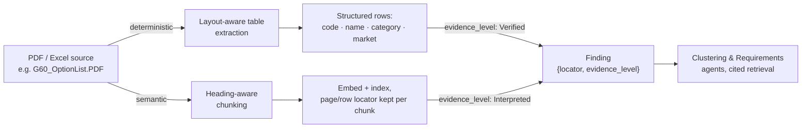

# Ingestion: turning a PDF or spreadsheet into a cited Finding

> Status: `draft` · Last updated: 2026-10-10 (implemented: PDFs and Excel loaded, see decision 0006)

The provided PDFs (`F70_OptionList.PDF`, `G60_OptionList.PDF`, `G70_OptionList.PDF`) are
structured option/equipment listings, not prose. Treating them as plain text to embed would throw
away exactly the structure that makes them useful, and would make every citation vague ("chunk
47"). Instead, every source is parsed on two tracks at once, and both converge on the same thing: a
`Finding` with a precise locator and an honest `evidence_level`.

## Tier 1 — deterministic (tables)

Pure ETL, no model in the loop: option code, name, category, market availability parsed straight
into a relational `Options` table. High trust by construction — `evidence_level = Verified`. Feeds
the Sales & Portfolio Agent directly, so qualitative feedback can be cross-checked against what
customers actually paid for.

## Tier 2 — semantic (narrative text, web content)

Any narrative text — in a PDF, in a web source the Competitor/Market Agents pull — is chunked by
heading, not by fixed token count, embedded (OpenAI `text-embedding-3-small`, stored in `chunk.embedding` in Supabase), and indexed with
its page/section locator kept on every chunk. Retrieval is always cited back to that locator. `evidence_level = Interpreted` by
default; the Critic Agent (see [`01-agents.md`](01-agents.md#the-critic-agent)) can downgrade it
further if the citation is thin.

For web sources specifically, `evidence_level` is instead set by source-trust tier — OEM/official
> trade press/reviews > forum/social — rather than by extraction method. Either grading can be
overridden by the PM on a specific finding (see
[`02-orchestration-and-human-in-the-loop.md`](02-orchestration-and-human-in-the-loop.md)); the
override is logged and feeds back into how that source is graded next time.

## Excel sources

`*_feedback_hackathon.xlsx`, `*_customer_studies.xlsx`, `sales_volumes.xlsx` are tabular already —
no extraction-tier split needed, but the same locator discipline applies: every `Finding` pulled
from a spreadsheet carries the sheet name, row, and column it came from, not just "from the
feedback file."

## As implemented (decision 0006)

Scripts live in `ingest/`; raw files stay in the gitignored `data/` folder. Both loaders are
idempotent (re-running replaces a file's rows) and need `OPENAI_API_KEY` and `SUPABASE_DB_URL` in `.env`.

### PDFs → `source` + `chunk` (`ingest/load_pdfs.py`, `ingest/pdf_chunks.py`)

- The three `*_OptionList.PDF` files are **German sales catalogs** (e.g. "BMW 5er Limousine Katalog
  Juli 2026", 23–28 pages), not clean option lists. They contain real selectable text, so no OCR.
- Text is extracted page by page with `pdftotext -layout`, split at ALL-CAPS headings, and capped
  at ~1,800 characters per chunk. 277 chunks in total (F70 75, G60 110, G70 92).
- Each `chunk` keeps `page`, `chunk_index`, `heading`, and the verbatim text; the embedding input
  is prefixed with the catalog title, page, and heading for better retrieval.
- Embedded with OpenAI `text-embedding-3-small` (1536 dims).
- `public.match_chunks()` does cosine search; `ingest/ask_pdf.py` answers questions. **Citations are
  built from the retrieved rows** (file, page, verbatim quote), never from model output.

Known limits: the equipment tables use ■ (standard) / □ (optional) marks in wide columns; flattened
text cannot tie a mark to a model variant, so the answer prompt forbids such claims. Some chunks
are small fragments cut mid-table (merge short chunks: open item). The Tier 1 "deterministic table
rows → `option`" extraction is **not built yet**; prices appear in the catalogs but are out of
scope for requirements.

### Excel → relational tables (`ingest/load_excel.py`)

| File | Table | Rows | Notes |
|---|---|---|---|
| `F70/G60/G70_feedback_hackathon.xlsx` | `feedback_raw` | 13,771 | One row per comment with all 12 original columns (`ext_id`, `country`, `engine_type`, `feedback_type`, `comment`, `vfc_label`, `vfc_level2/3`, …) plus sheet and row. Comment embedded. |
| `sales_volumes.xlsx` | `sales_volume` | 36 | Sheet (F70, G60_G68, G70) × market × year; 2030 flagged `is_forecast`. |
| `F70_G60_G68_G70_customer_studies.xlsx` | `study_response` | 1,627 | Cross-tabs unpacked to rows: China/EU sheet → `mean` per model; US sheet → answer `share` per model. Cell reference kept. No respondent counts exist in the file. |

`public.match_feedback()` does cosine search over comments with optional vehicle-line and country
filters. Counts, sample sizes and uptake come from SQL on these tables; only comments and PDF text
are searched by meaning. `finding` rows are **not yet derived** from `feedback_raw` (that is the
Customer Feedback Agent's job).
