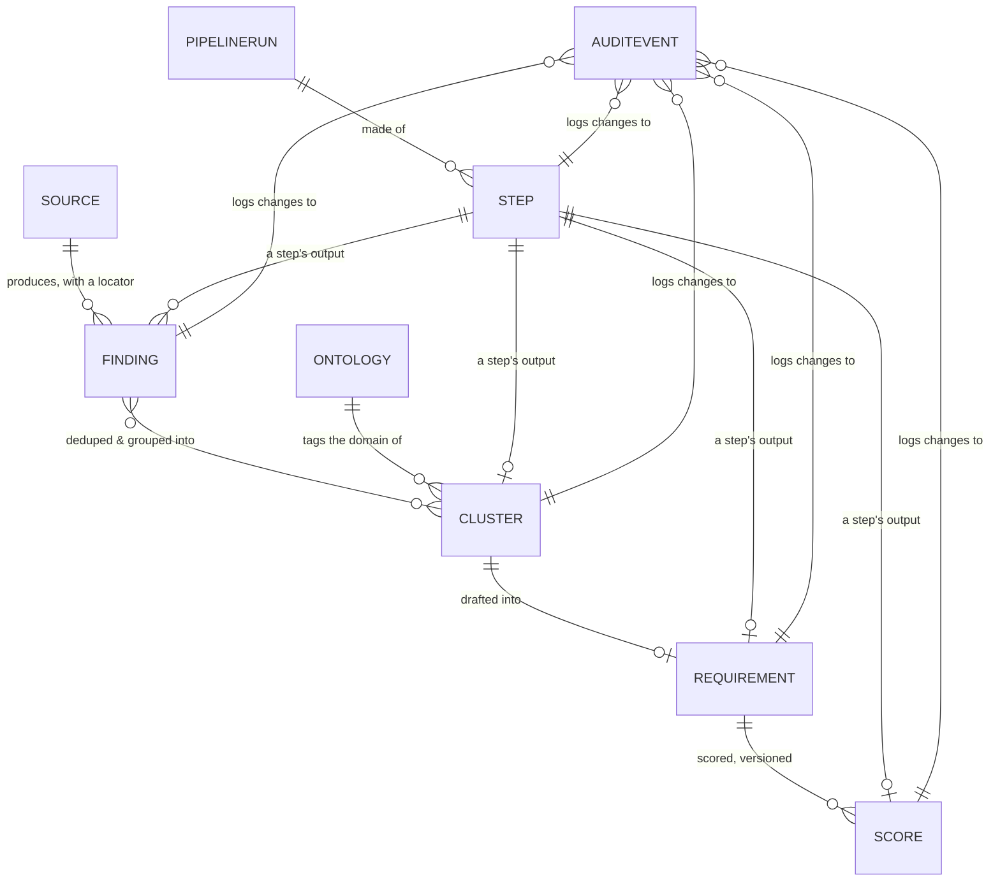

# Data model

> Status: `draft` · Last updated: 2026-10-11 (orchestrated steps, checkpoint tables)

Everything is traceable because everything points backward. A PM looking at a requirement can walk
back to the exact cell or paragraph that produced it; a PM looking at the audit log can tell who or
what changed what, and why.

## Source

`id, type (internal_pdf | internal_xlsx | web), uri, vehicle_line, market, retrieved_at`

## Finding

`id, source_id, locator (page/row/cell or url+retrieved_at), text, signal_type (complaint |
unmet_need | competitor_advantage | market_trend | praise), evidence_level (Verified | Interpreted
| source-trust tier), sentiment, sample_size, market, extracted_by, created_at`

See [`03-ingestion.md`](03-ingestion.md) for how `locator` and `evidence_level` get set.

## Cluster

`id, label, ontology_domain_id, member_finding_ids[], created_at`

## Ontology

`id, kind (domain | market | vehicle_line), key, label, parent_id (nullable), active`

A first-class, editable store rather than a hardcoded enum — see
[`08-scaling-and-config.md`](08-scaling-and-config.md). This is what makes the domain taxonomy
(Exterior/Interior/Powertrain/…) and the vehicle-line/market lists config, not code.

## Requirement

`id, title, description, ontology_domain_id, markets[], vehicle_line, metric,
acceptance_criteria, evidence_level, assumptions[], uncertainties[], status (draft | pm_review |
tracked | rejected | challenged | superseded | proposed), linked_finding_ids[],
linked_cluster_ids[], origin (scheduled_pipeline | pm_query), created_by_run_id`

`status` transitions are defined in [`05-requirement-lifecycle.md`](05-requirement-lifecycle.md).

## Score

`id, requirement_id, customer_relevance, business_signal, strategic_fit, effort_proxy, confidence,
composite, weight_vector_version, rationale, computed_by, computed_at`

Versioned — a new `Score` row per re-scoring, never an overwrite. See
[`06-prioritization.md`](06-prioritization.md).

## AuditEvent

`id, entity_type, entity_id, actor (agent name | pm user), action, before, after, rationale,
timestamp`

Append-only. See [`07-audit-trail.md`](07-audit-trail.md).

## PipelineRun & Step

Introduced in [`02-orchestration-and-human-in-the-loop.md`](02-orchestration-and-human-in-the-loop.md).

**PipelineRun:** `id, trigger (scheduled | pm_query), vehicle_line, market, query_text (nullable),
status (in_progress | completed | aborted), created_by, created_at`

**Step:** `id, run_id, agent_name, stage, depends_on_step_ids[], status (planned | running |
awaiting_review | accepted | rejected), plan_reason, planned_by (orchestrator | pm), human_readable_summary, structured_output_refs[],
launched_by, launched_at, resolved_by, resolved_at, pm_note`

Every start, finish and failure of a `Step` is also an `AuditEvent` (actor `orchestrator`, with the reason for the call) — the run itself
is fully reconstructable from the audit log alone. Since [decision 0018](../decisions/0018-orchestrator-decides-in-an-agentic-loop.md) steps are created `running`
and end `accepted` or `rejected` by themselves; `planned`, `awaiting_review` and `planned_by = pm` are no longer used, and
`pm_note` holds the failure reason of a rejected step.

## As implemented (Supabase, `supabase/migrations/20261010_init_schema.sql`)

Differences and additions relative to the sketch above:

- **Extra tables:** `chunk` (Tier 2 heading-aware text chunks with their own locator, `page`,
  `chunk_index` and embedding), `option` + `option_availability` (Tier 1 equipment rows with per-variant standard/optional status and
  price, 198 + 1,352 rows),
  raw-data tables `feedback_raw`, `sales_volume`, `study_response` (see
  [`03-ingestion.md`](03-ingestion.md#as-implemented-decision-0006)), and join tables `cluster_finding`,
  `requirement_finding`, `requirement_cluster` in place of the `member_finding_ids[]` /
  `linked_*_ids[]` arrays.
- **Embeddings:** `finding.embedding`, `chunk.embedding` and `feedback_raw.embedding`, `vector(1536)`, HNSW cosine indexes.
- **Enum additions:** `finding.signal_type` also allows `business_signal` and
  `strategic_continuity`; `evidence_level` also allows `Unverified`.
- **Extra columns:** `requirement.code` (human id such as `R-2031`, next to the UUID key),
  `finding.out_of_scope_reason` (set when routed to the regulatory/pricing bin),
  `source.trust_tier`, `finding.vehicle_line`.
- **Audit log is append-only in the database**, not just by convention: triggers block update,
  delete, and truncate on `audit_event`.
- **Search functions:** `match_chunks()` (PDF text) and `match_feedback()` (customer comments),
  both cosine distance over the HNSW indexes.
- **Ontology seeded:** 10 domains, 4 vehicle lines (F70, G60, G68, G70), 4 markets, and 222 customer-feedback
  category labels as children of the domains (`backend/app/ingest/seed_ontology.py`; labels classified by an
  OpenAI model plus hand overrides, 3 non-product labels left unmapped).
- **Knowledge layer (decision 0008):** `feedback_raw`, `study_response`, `sales_volume` and `finding`
  carry normalized `vehicle_line`, `market_code`, `domain_id`, `polarity`, `powertrain` where they apply;
  reference tables `country_market` and `model_variant`; `finding_evidence` (one FK per cited row, five
  kinds); view `evidence_item`; hybrid search functions `search_feedback` and `search_docs`. See
  [`11-knowledge-layer.md`](11-knowledge-layer.md).
- **Row counts today:** `chunk` 149, `feedback_raw` 13,771, `sales_volume` 36, `study_response`
  1,627. `finding`, `cluster`, `requirement`, `score` are still empty.
- **Docs mirror:** `design_decisions` and `architecture_docs` hold a copy of these docs after each
  push (see `AGENTS.md`). Git stays the source of truth.
- **Access:** RLS enabled on all tables, no policies yet (backend-only access).

## Conversation & Message (chat entry point)

Added by [decision 0005](../decisions/0005-chat-entry-and-orchestrator-planned-steps.md); in the database
since `supabase/migrations/20261011_chat_tables.sql`.

**Conversation:** `id, title, created_by, vehicle_line, market_code, status (active | archived),
created_at, updated_at`. `updated_at` moves forward by trigger whenever a message is added, so the
conversation list sorts by recent activity. A conversation that has runs cannot be deleted (runs hold the
audit trail): archive it instead. One without runs can be deleted and its messages go with it.

**Message:** `id, seq, conversation_id, role (pm | orchestrator | agent | system), kind (request | plan |
plan_change | step_card | pushback | final_result | system_note), run_id, step_id, content, payload (jsonb),
created_at`. `content` is the text shown in the thread; `payload` holds the structured part of a card (plan
items, citations, summary sections). A `step_card` or `pushback` must have a `step_id`. `seq` is an identity number that orders the thread:
`created_at` cannot, because messages written in one transaction share the same timestamp.

**PipelineRun** gains `conversation_id`. **Step** now has the states `planned | running |
awaiting_review | accepted | rejected` (the old `queued` and `awaiting_launch` are gone) and the columns
`position` (order in the plan, unique per run), `plan_reason`, `planned_by (orchestrator | pm)` and
`attempt` (incremented by every Retry); `pm_note` holds the latest steering note.

The database enforces the one-at-a-time rule: a unique partial index allows at most one step per run in
`running` or `awaiting_review`. `backend/app/orchestration/steps.py` holds the transition rules and a test
checks that its states match the migration.

**Checkpoint tables** (`checkpoints`, `checkpoint_blobs`, `checkpoint_writes`, `checkpoint_migrations`; migration
`20261014_langgraph_checkpoints.sql`) belong to LangGraph, not to this model. They hold each run's control-flow state
(thread id = `pipeline_run.id`) so a run resumes after a restart ([decision 0019](../decisions/0019-orchestration-loop-runs-on-langgraph.md));
nothing in the UI or the audit trail is read from them.

## AppUser & AuthSession (sign-in)

Added by [decision 0016](../decisions/0016-backend-owned-authentication.md); in the database since `20261013_auth.sql`.

**AppUser:** `id, email (lower case, unique), display_name, password_hash (scrypt), role (pm | admin), active,
failed_attempts, locked_until, last_login_at, created_at`.

**AuthSession:** `id, user_id, token_hash (SHA-256 of the random token, unique), created_at, expires_at, last_used_at,
revoked_at`. The token itself is never stored. The signed-in user's email is written to `conversation.created_by`,
`pipeline_run.created_by`, `message.payload.author` (PM messages) and `audit_event.actor` (plan edits and every step action); the planner's
`plan_created` event records `requested_by`.

## Model comparison evidence (decision 0025)

The protected model-overview API uses `comparison_model` (dataset/manual/rival identities),
`comparison_research` (bounded collection and validation runs), `comparison_observation`
(variant/market facts, numeric intervals or qualitative claims, units, basis, standard, period,
powertrain, immutable passage reference, quotes and evaluation time), and `comparison_rival`
(explicit per-anchor/variant/market cohort with selection rationale). All four tables enable RLS
without public policies. `source.retrieved_at` records a web snapshot's crawl time. Recrawls append
source/passages rather than replace cited evidence. `conversation` binds model ID/variant/market;
`pipeline_run.comparison_context` freezes the server comparison packet for reproducible chat answers.
See [competitor benchmarking](10-competitor-benchmarking.md) for median/mean and interval rules.
