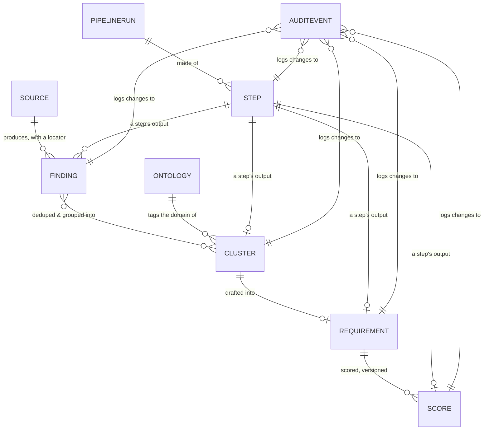

# Data model

> Status: `draft` · Last updated: 2026-10-10 (raw Excel tables and PDF citation columns added)

Everything is traceable because everything points backward. A PM looking at a requirement can walk
back to the exact cell or paragraph that produced it; a PM looking at the audit log can tell who or
what changed what, and why.

## Source

`id, type (internal_pdf | internal_xlsx | web), uri, vehicle_line, market, retrieved_at`

## Finding

`id, source_id, locator (page/row/cell or url+retrieved_at), text, signal_type (complaint |
unmet_need | competitor_advantage | market_trend | praise), evidence_level (Verified | Interpreted
| source-trust tier), sentiment, sample_size, market, extracted_by, created_at`

See [`03-ingestion.md`](03-ingestion.md) for how `locator` and `evidence_level` get set.

## Cluster

`id, label, ontology_domain_id, member_finding_ids[], created_at`

## Ontology

`id, kind (domain | market | vehicle_line), key, label, parent_id (nullable), active`

A first-class, editable store rather than a hardcoded enum — see
[`08-scaling-and-config.md`](08-scaling-and-config.md). This is what makes the domain taxonomy
(Exterior/Interior/Powertrain/…) and the vehicle-line/market lists config, not code.

## Requirement

`id, title, description, ontology_domain_id, markets[], vehicle_line, metric,
acceptance_criteria, evidence_level, assumptions[], uncertainties[], status (draft | pm_review |
tracked | rejected | challenged | superseded | proposed), linked_finding_ids[],
linked_cluster_ids[], origin (scheduled_pipeline | pm_query), created_by_run_id`

`status` transitions are defined in [`05-requirement-lifecycle.md`](05-requirement-lifecycle.md).

## Score

`id, requirement_id, customer_relevance, business_signal, strategic_fit, effort_proxy, confidence,
composite, weight_vector_version, rationale, computed_by, computed_at`

Versioned — a new `Score` row per re-scoring, never an overwrite. See
[`06-prioritization.md`](06-prioritization.md).

## AuditEvent

`id, entity_type, entity_id, actor (agent name | pm user), action, before, after, rationale,
timestamp`

Append-only. See [`07-audit-trail.md`](07-audit-trail.md).

## PipelineRun & Step

Introduced in [`02-orchestration-and-human-in-the-loop.md`](02-orchestration-and-human-in-the-loop.md).

**PipelineRun:** `id, trigger (scheduled | pm_query), vehicle_line, market, query_text (nullable),
status (in_progress | completed | aborted), created_by, created_at`

**Step:** `id, run_id, agent_name, stage, depends_on_step_ids[], status (planned | running |
awaiting_review | accepted | rejected), plan_reason, planned_by (orchestrator | pm), human_readable_summary, structured_output_refs[],
launched_by, launched_at, resolved_by, resolved_at, pm_note`

Every launch, accept, edit, retry, and reject on a `Step` is also an `AuditEvent` — the run itself
is fully reconstructable from the audit log alone.

## As implemented (Supabase, `supabase/migrations/20261010_init_schema.sql`)

Differences and additions relative to the sketch above:

- **Extra tables:** `chunk` (Tier 2 heading-aware text chunks with their own locator, `page`,
  `chunk_index` and embedding), `option` (Tier 1 deterministic option-list rows, **empty so far**),
  raw-data tables `feedback_raw`, `sales_volume`, `study_response` (see
  [`03-ingestion.md`](03-ingestion.md#as-implemented-decision-0006)), and join tables `cluster_finding`,
  `requirement_finding`, `requirement_cluster` in place of the `member_finding_ids[]` /
  `linked_*_ids[]` arrays.
- **Embeddings:** `finding.embedding`, `chunk.embedding` and `feedback_raw.embedding`, `vector(1536)`, HNSW cosine indexes.
- **Enum additions:** `finding.signal_type` also allows `business_signal` and
  `strategic_continuity`; `evidence_level` also allows `Unverified`.
- **Extra columns:** `requirement.code` (human id such as `R-2031`, next to the UUID key),
  `finding.out_of_scope_reason` (set when routed to the regulatory/pricing bin),
  `source.trust_tier`, `finding.vehicle_line`.
- **Audit log is append-only in the database**, not just by convention: triggers block update,
  delete, and truncate on `audit_event`.
- **Search functions:** `match_chunks()` (PDF text) and `match_feedback()` (customer comments),
  both cosine distance over the HNSW indexes.
- **Row counts today:** `chunk` 277, `feedback_raw` 13,771, `sales_volume` 36, `study_response`
  1,627. `finding`, `cluster`, `requirement`, `score` are still empty.
- **Docs mirror:** `design_decisions` and `architecture_docs` hold a copy of these docs after each
  push (see `CLAUDE.md`). Git stays the source of truth.
- **Access:** RLS enabled on all tables, no policies yet (backend-only access).

## Conversation & Message (chat entry point, not yet in the database)

Added by [decision 0005](../decisions/0005-chat-entry-and-orchestrator-planned-steps.md).

**Conversation:** `id, title, created_by, vehicle_line, market, created_at`

**Message:** `id, conversation_id, role (pm | orchestrator | agent | system), kind (request | plan |
step_card | pushback | final_result), step_id (nullable), run_id (nullable), content, created_at`

`PipelineRun` gains `conversation_id`. The Supabase tables currently still have the old `step.status`
values (`queued`, `awaiting_launch`) and no chat tables; a migration is pending.
