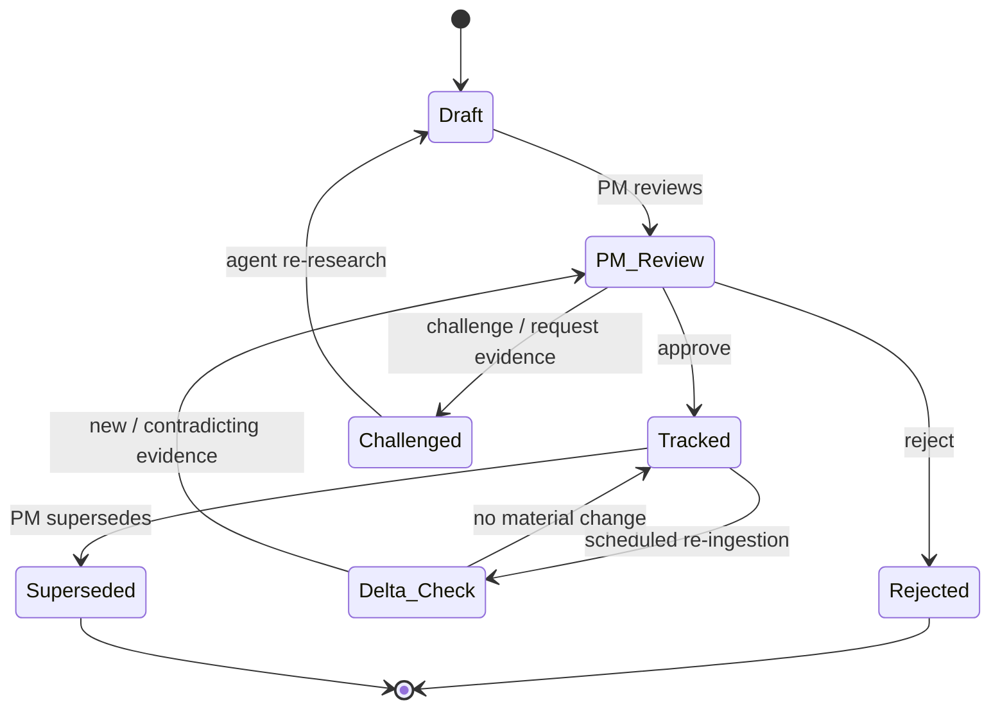

# Requirement lifecycle & the two-year tracking loop

> Status: `building` · Last updated: 2026-10-10 (register, decisions and tracking check implemented, see [0022](../decisions/0022-requirement-register-and-process-views.md))

This is the *long-horizon* state of a requirement once it has made it out of a
[run](02-orchestration-and-human-in-the-loop.md) — weeks to months, across the life of the
~two-year requirements program, not the minutes-scale step-by-step approval inside a single run.

- **`Draft` and `Delta_Check` run unattended.** Every other transition needs a PM action and a
  recorded reason — same four verbs as everywhere else in this system: approve, reject, edit
  (not shown as a separate state — it mutates `Draft` in place), challenge.
- **"No material change" stays quiet.** The Delta Agent re-checks tracked requirements against
  freshly ingested evidence on a recurring schedule (~quarterly) and only re-opens `PM_Review` when
  something actually moved — new corroboration, a contradiction, or evidence old enough to flag as
  stale. It never updates a tracked requirement's status on its own.
- **This is the "requirements tracking" loop** from BMW's own process slide, and the mechanism
  behind "the requirement process isn't performed once — it's a process over ~2 years."

## Relationship to the per-run approval chain

A requirement enters this state machine at `Draft` the moment a
[`PipelineRun`](02-orchestration-and-human-in-the-loop.md#data-model-additions)'s Documentation
step is accepted. Everything before that — the orchestrator's plan, reviewing each agent's
human-readable output in the chat, retrying or rejecting a step — happens *inside* the run, at a finer grain than this
diagram shows. Think of this doc as "what happens after the research is done and a requirement
exists," and [`02-orchestration-and-human-in-the-loop.md`](02-orchestration-and-human-in-the-loop.md)
as "how the research itself gets approved."

## Committee / board mode

For the "large committee discusses this" pattern: several `Tracked`-or-`PM_Review` requirements
can be bundled into a generated board pack (a set of Documentation Agent dossiers). The
committee's collective call is still recorded as **one** audit event, with participants and
rationale noted, against one accountable PM — diffusing the discussion is fine, diffusing
accountability for the recorded decision is not.
