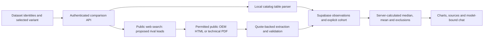

# Model overviews and competitor benchmarking

> Status: `building` · Last updated: 2026-10-11

See [decision 0025](../decisions/0025-server-owned-model-comparisons.md). Model overviews are a
protected backend API feature backed by Supabase. The browser never reads the database directly
or computes comparison benchmarks. Germany/Europe is the user-selected default market.

## Identity and scope

`app.knowledge.models` discovers family names from `study_response.model` and the active vehicle-line
ontology, then loads every variant from `model_variant`. There is no hardcoded model roster, rival
list, specification value, rating, sales forecast or market average in the frontend. Models added
manually have their own registry identity. Bare chassis identifiers are not reliable web identities:
BMW G70 must not be mistaken for Genesis G70. G68 remains the China-specific dataset model and is
not silently merged with the German G60.

Every overview fixes a model, variant and market. The dataset currently contains family-level
customer studies and feedback alongside variant-level catalog tables. The UI labels this granularity;
family-level opinions are not represented as measurements of a specific engine variant.

## Collection and validation

The existing web search service proposes candidates. Leads and selection rationales are interpretations,
not verified competitor performance. Each URL must appear in an actual search-tool result. A safe
HTTP fetch validates public addresses and redirects, honors robots.txt and bounds size/time. Login,
bot checks, unavailable robots files, oversized documents and JavaScript-only pages become visible
coverage gaps. No access restriction is bypassed.

Internal catalog extraction is deterministic and local: match registered variant names against the
technical table header, use the corresponding column, preserve the complete row/header and omit
incomplete or ambiguous cells. System power is distinct from a hybrid's combustion-engine power.
Fuel/energy intervals stay intervals; seats-up boot capacity is distinct from seats-folded capacity.

Public-source extraction proposes facts from fetched passages. Backend validation requires an actual
passage ID, a verbatim quote, a scope quote, an exact numeric token in canonical units, the expected
powertrain and an explicit WLTP/EPA/CLTC standard where applicable. The source panel exposes the
complete stored passage so a human can check interpretation and identity. These are extracted claims,
not independently certified measurements.

## Benchmarks and diagrams

One selected rival family contributes once per metric. Exclude the reference model. Units, test
standards, powertrain, measurement basis and period must match. Missing or incompatible observations
and conflicting values in a source snapshot have no vote and have an explicit exclusion reason.

For comparable point values: mean is `sum(values)/n`; median is the middle sorted value, averaging the
two middle values for even n. For comparable reported intervals, calculate median and mean separately
for lower and upper endpoints and plot both endpoints. Never collapse an interval to a midpoint or
call the selected cohort the entire market. n is a count of models, not a customer sample size.

The compact overview displays up to six numerical charts with distinct reference, rival, median and
mean treatments, and can expand all metrics. Each chart exposes individual values, interval bounds,
contributors, exclusions and citations. Qualitative sections use a sourced comparison matrix: no
invented scores or statistical median of text. Internal feedback counts, study scores/shares and
sales rows are shown separately with their actual file/cell/row provenance. Forecasts are labelled.

## Freshness and reevaluation

`source.retrieved_at` is the crawl time for a web snapshot; `comparison_observation.extracted_at` is
the evaluation time. The overview has a separate calculation timestamp. These clocks are not
interchangeable. Every rival card can crawl its official sources directly, including a rival with zero existing
observations, and reevaluate stored rival snapshots. Both actions use the same protected validation
API with a cohort-scoped `rival_id`. Recrawling one source saves a new source and passage snapshot. Reevaluation reads
current database evidence and re-extracts stored public snapshots, without changing their crawl date.
Prior values and citations remain available. An unsuccessful refresh retains the earlier evidence
with its original timestamps and a failure/coverage note.

## API

| Endpoint | Behavior |
|---|---|
| `GET /api/models` | Database-derived families, variants, manual models and market choices |
| `POST /api/models` | Register a manually supplied full model identity |
| `GET /api/models/{id}/overview?variant=...&market=...` | Read evidence and calculate current benchmarks on the server |
| `POST /api/models/{id}/research` | Discover/scrape competitors, or research a manually supplied rival |
| `PATCH /api/models/{id}/rivals/{cohort_id}` | Remove/include a rival in the explicit cohort |
| `POST /api/models/{id}/validate` | Reevaluate all evidence or reevaluate/recrawl one observation source |

These routes require the existing application session. Collection remains inside a bounded request
suitable for the Vercel function duration; interrupted requests have a research record and can be retried.

## Model chat

The existing chat accepts optional registry ID, variant and market at creation. The backend validates
this binding and every request snapshots the current comparison packet in `pipeline_run.comparison_context`.
The first Competitor Agent call answers from this packet and citable dataset/web evidence. The remaining
orchestrator/agent flow stays available. Untrusted source text cannot override the fixed identity,
cohort or market. A model without a BMW line uses `EXTERNAL`, not `ALL`, for internal retrieval.

The earlier proposed per-agent PM gates in this document are superseded by decision 0018. A user may
edit the cohort and manually add models; this is configuration of the comparison, not step approval.

Manual competitor entry can optionally specify an exact variant and public source URL. This lets
the PM correct unsuitable discovery pages without changing the verification rules: SSRF and
redirect checks, robots.txt, exact source quotations and variant matching still apply. The
selection is labelled manual. An inaccessible page remains a coverage gap.
