# Competitor benchmarking: from one BMW to a comparable rival set

> Status: `draft` · Last updated: 2026-10-10

[`01-agents.md`](01-agents.md) says the Competitor Agent "searches the web for competitor specs and
reviews." That hides the hard part: *which* competitors, and how their evidence is made comparable
to ours. This doc is a proposed processing structure for exactly that — start from one BMW (demo:
5 Series / G60), end with findings that say where rivals in the same bracket are ahead or behind
*as customers experience it*.

## The six stages

```mermaid
flowchart LR
    A["1 Anchor<br/>fix one vehicle<br/>→ VehicleProfile"]
    B["2 Segment definition<br/>bands on price · range ·<br/>seats · equipment"]
    G1{{"PM gate:<br/>confirm bands"}}
    C["3 Long-list<br/>load every model<br/>inside the bands"]
    D["4 Shortlist<br/>rank by similarity,<br/>split by market"]
    G2{{"PM gate:<br/>pick rivals"}}
    E["5 Evidence collection<br/>specs · reviews ·<br/>owner reports"]
    F["6 Relative comparison<br/>per aspect, vs. the<br/>anchor's own feedback"]
    G3{{"PM gate:<br/>accept findings"}}
    A --> B --> G1 --> C --> D --> G2 --> E --> F --> G3
```

### 1 — Anchor: fix one vehicle

"5 Series" is not one car: it spans combustion, plug-in and electric (i5), saloon and Touring, and
a price range wide enough to overlap two segments. The PM picks a vehicle line **and** an anchor
variant (or a small set of them); everything downstream is relative to that.

Output is a `VehicleProfile` — the same structure later filled in for every rival:

| Attribute | Example (illustrative) | Filled from |
|---|---|---|
| body style, seats | saloon, 5 | OptionList / official spec |
| powertrain | BEV | official spec |
| base price, typical transaction price | per market, in local currency | official price list |
| range / consumption | WLTP (EU), EPA (US), CLTC (CN) | official spec |
| dimensions, boot volume | length, wheelbase, litres | official spec |
| equipment flags | standard vs. optional per feature | parsed `Options` table ([`03-ingestion.md`](03-ingestion.md)) |

Every value carries a source locator, like any other `Finding`.

### 2 — Segment definition: what "the same bracket" means

A `SegmentDefinition` is a set of criteria over `VehicleProfile` attributes, each either a **hard
filter** (outside → excluded) or a **soft criterion** (only affects similarity ranking).

| Criterion | Default derived from the anchor | Kind |
|---|---|---|
| Price | anchor base price −15 % … +25 % | hard |
| Body style | same class (saloon/estate ↔ saloon/estate) | hard |
| Seats | equal | hard |
| Powertrain | same type | soft (hard if PM wants BEV-only) |
| Range | ±20 % | soft |
| Dimensions | length ±5 % | soft |
| Equipment level | overlap of standard-equipment flags | soft |

The percentages are placeholders to be calibrated, and the defaults are a proposal, not a rule:
**the PM can override any band by hand** ("price 55–80 k €", "include PHEVs") before anything is
searched. The chosen bands are stored with the run, so the rival set is reproducible and an auditor
can see *why* a car was in or out.

Price is used here only to draw the bracket. It never becomes a requirement — pricing stays out of
scope per [`00-overview.md`](00-overview.md#scope).

### 3 — Long-list: load every model inside the bands

Goal is recall, not precision: every model on sale in the target market that passes the hard
filters. Two sources, merged and deduplicated on `(make, model, generation, variant)`:

- **Structured catalogues first** — official manufacturer spec/price pages and public vehicle
  databases. `official` trust tier, deterministic parse where possible.
- **Web search as a gap-filler** — "alternatives to …" / comparison-test articles surface rivals
  the catalogue pass missed (new entrants, China-only brands).

Each candidate gets a `VehicleProfile`. Attributes that could not be sourced stay `null` and are
shown as such — a missing range figure must not silently pass a range filter.

### 4 — Shortlist: pick the comparison vehicles

Candidates are ranked by a similarity score (weighted distance over the soft criteria, weights
visible and editable). The PM sees a table per market and ticks the rivals to carry forward —
typically 3–6 per market.

Markets are separate lists, not one global one: a rival that matters in China may not be sold in
Europe at all. Result is a `CompetitorSet` per `(anchor, market)`.

### 5 — Evidence collection: scrape per shortlisted rival

For each rival, the existing web ingestion path is reused (robots.txt respected, trust tier per
domain from the domain config, unknown domains treated as the lowest tier):

| Source type | Trust tier | Used for |
|---|---|---|
| Manufacturer spec / price pages | `official` | completing the `VehicleProfile` |
| Comparison tests, long-term reviews | `trade_press` | expert judgement per aspect |
| Owner reviews, forums | `forum_social` | customer experience — the counterpart to our own feedback data |

Text is chunked, classified onto the same domain taxonomy as BMW's own feedback
([`08-scaling-and-config.md`](08-scaling-and-config.md)), and stored as `Finding`s tagged with the
rival's `vehicle_id`.

### 6 — Relative comparison against the anchor

This is where apples meet pears: BMW's side is internal survey data with known sample sizes, the
rival's side is scraped public text. Putting raw numbers next to each other would be misleading.
The comparison is therefore constrained on purpose:

1. **Compare per aspect, never per car.** Unit of comparison is one ontology domain or sub-topic
   ("rear legroom", "charging speed", "infotainment responsiveness"), not an overall verdict.
2. **Like with like.** Owner voice is compared with owner voice, expert tests with expert tests,
   spec with spec. For the anchor, the same public sources are scraped too — so the public-data
   comparison is BMW-public vs. rival-public, and the internal feedback is used to *confirm or
   contradict* it, not as the other side of the scale.
3. **Relative, not absolute.** Per aspect and source type: share of mentions and sentiment balance
   within that vehicle's own corpus. "18 % of rival-X owner posts mention charging, mostly
   positive; 9 % of 5 Series posts do, mostly negative" is comparable; raw counts are not.
4. **Hard facts stay hard.** Spec deltas (range, boot litres, standard equipment) are compared
   directly and marked `Verified` — same measurement standard only (no WLTP vs. EPA).
5. **Thin evidence is shown as thin.** An aspect with fewer than *n* mentions on either side yields
   "insufficient data", not a finding.

Output per aspect is a `ComparisonCell`: `anchor value · rival value · delta · source type ·
n on each side · evidence_level`. Cells with a clear delta become `Finding`s — `competitor_advantage`
where the rival leads, and (proposed new signal type) `competitor_weakness` where BMW leads and the
lead is worth defending. From there they enter clustering like any other finding.

## How this fits the step model

In [`02-orchestration-and-human-in-the-loop.md`](02-orchestration-and-human-in-the-loop.md) the
Competitor Agent is one `Step`. Running stages 1–6 unattended inside it would be exactly what that
doc argues against — a wrong price band at stage 2 invalidates everything after it. Proposal: split
it into three chained steps, each with the usual Run / Accept / Edit / Retry / Reject card.

| Step | Stages | What the PM reviews |
|---|---|---|
| Competitor Scoping | 1–2 | anchor profile + proposed bands; **Edit** = override bands |
| Competitor Selection | 3–4 | ranked long-list per market; **Edit** = tick/untick rivals |
| Competitor Evidence & Comparison | 5–6 | comparison matrix + resulting findings |

The other four Situation Analysis agents stay independent of these and can run in parallel.

This is a proposal only: `02` and [`04-data-model.md`](04-data-model.md) are not yet updated, and
adopting it needs an entry in [`../decisions/`](../decisions/).

## Data model additions (proposed)

- **Vehicle:** `id, make, model, generation, variant, is_anchor`
- **VehicleProfile:** `vehicle_id, market, attribute, value, unit, source_id, locator`
  (long format — one row per attribute, so every value is individually cited and may be `null`)
- **SegmentDefinition:** `id, run_id, anchor_vehicle_id, criteria[] {attribute, min, max, kind
  (hard | soft), weight, set_by (default | pm)}`
- **CompetitorSet:** `id, segment_definition_id, market, vehicle_ids[], similarity_scores{}`
- **ComparisonCell:** `id, competitor_set_id, rival_vehicle_id, ontology_domain_id, source_type,
  anchor_value, rival_value, delta, n_anchor, n_rival, evidence_level`
- **Finding** gains a nullable `vehicle_id` so rival evidence is distinguishable from BMW evidence.

## Open questions

- Which structured catalogue is reliable and legally usable per market (EU / US / CN)?
- Transaction price vs. list price for the band — list price is sourceable, transaction price is
  what customers actually compare.
- Minimum-mention threshold *n* for a comparison cell; needs calibrating on real scraped volume.
- Whether three competitor steps is too much clicking for the demo — fallback is one step with the
  band and shortlist confirmations as inline prompts.
