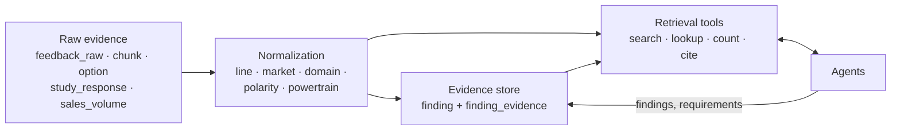

# Knowledge layer: normalized evidence the agents can query

> Status: `stable` for normalization and retrieval, `building` for findings · Last updated: 2026-10-11 (feature-specific and verified public market evidence; see [decision 0030](../decisions/0030-feature-specific-and-public-market-evidence.md))

The knowledge layer sits between ingestion and the agents. Ingestion parses files and keeps
provenance per row and page ([`03-ingestion.md`](03-ingestion.md)); the knowledge layer makes those
rows speak **one vocabulary**, stores **findings that cite them**, and gives agents **one retrieval
interface** that can only return citable evidence.

## 1. Normalization

Every evidence table carries the same filter fields, so one question can span sources:

| Field | Values | Where it comes from |
|---|---|---|
| `vehicle_line` | F70, G60, G68, G70 | feedback `derivate`; study model name; sales sheet |
| `market_code` | EU, CN, US, RoW | feedback `country` via the `country_market` table; study sheet; sales row |
| `domain_id` | ontology domain / category | feedback `vfc_level2` label → ontology child → parent domain |
| `polarity` | positive, negative, request | feedback type: Likes → positive; Difficult to Use, Defect → negative; Wants → request |
| `powertrain` | ICE, PHEV, BEV | feedback engine type (`BEVE` → BEV); `model_variant` for catalog variants |

Reference data is in tables, not code: `country_market` (country → market) and `model_variant`
(catalog variant → line and powertrain, e.g. G60 `i5 eDrive40` → BEV, `530e` → PHEV). `option_availability`
links to `model_variant`, so "what is standard on the plug-in hybrids" is a join.

Assumptions to confirm with BMW (all recorded here so nobody has to rediscover them):
- GB and Norway count as **Europe (EU)** for market purposes.
- `BEVE` in the feedback files means battery-electric. It occurs only for G60 and G70, matching the
  catalogs' i5 and i7 variants, and never for F70, which has no electric variant.
- The `G60_G68` sales sheet covers two lines. G68 is the Chinese 5 Series variant, so its China row is
  assigned to **G68** and its other rows to **G60**.
- Powertrain of catalog variants is derived from the model names (i5/i7 → BEV, 530e/550e → PHEV,
  rest ICE).

## 2. Evidence store

`finding` is a cited claim, for example "312 US G60 comments report weak seat ventilation". Each
finding links to the raw rows behind it through `finding_evidence`, which holds exactly one reference
per row (feedback comment, study cell, sales row, option or PDF chunk) with foreign keys, so a finding
cannot point at a row that does not exist. `finding` also carries `domain_id`, `polarity`, `market`,
`sample_size`, `evidence_level` and an embedding.

The `evidence_item` view unions all five raw kinds into one shape (`kind`, `id`, line, market, `file`,
`locator`, `text`); `cite(kind, id)` reads from it. That is the single definition of "what can be cited".

## 3. Retrieval tools (`backend/app/knowledge/tools.py`, exposed over HTTP by `backend/app/api/evidence.py`)

| Tool | Use | Backed by |
|---|---|---|
| `search_feedback(query, line, market, domain, polarity, powertrain)` | what customers say | hybrid vector + keyword search (SQL function, rank fusion) |
| `search_docs(query, line)` | catalog text (German) | hybrid search over PDF chunks |
| `get_options(line, variant, status, text)` | what is standard or optional, at what price | `option`, `option_availability`, `model_variant` |
| `get_sales(line, market, year)` | volumes and the 2030 forecast | `sales_volume` |
| `get_study(line, market, question)` | satisfaction scores and answer shares | `study_response` |
| `feedback_stats(group_by, filters)` | exact counts | SQL aggregate, not sampled |
| `feedback_rows(filters)` | the rows behind a count, for evidence links | SQL |
| `feature_feedback(terms, line, limit_per_market)` | local equipment-topic matches, exact polarity counts, and up to 12 distinct sample citations per market | boundary-aware, escaped literal SQL matching; no embeddings or external model |
| `cite(kind, id)` | resolve any row to file, locator and quote | `evidence_item` |

Every `Hit` returned carries a `Citation` (file, locator, verbatim quote). Counts and numbers come
from SQL; only meaning-based matching uses embeddings. Keyword search matters because part numbers,
model names and option codes embed poorly.

Market impact matches exact feature names and explicit German/English functional synonyms locally. SQL deduplicates
normalized comment text within each line/market before topic counts and a balanced citation sample are returned.
The assessment interprets feature-specific passages in the bounded sample; whole-comment polarity is never used as
an option verdict. Explicit preferences or unmet demand indicate potential benefits, implementation/cost/acceptance
problems indicate risks, conflicting evidence remains mixed, and ambiguous passages remain unclear. These local
rules can miss paraphrases and are disclosed as sample interpretations, not population estimates or causal effects.

Public research uses the existing Responses API web-search tool with generic public feature terms and public BMW
model names. Internal comments, row metadata, IDs, counts and private catalog labels are never included. Candidate
pages are fetched through `public_web_text`, using the existing public DNS and redirect checks, body limits and
timeouts. Only short verbatim passages from fetched pages can be cited. Model relevance/stance extraction is an
interpretation; a market-specific direction requires an actual source geography passage. Shopping sites are
excluded; manufacturer availability and social anecdotes are context. A country outside US/Europe/China does not
establish a direction for heterogeneous RoW. Sources that cannot be fetched/verified produce a visible evidence gap.
Public results are bounded and cached for 15 minutes in process memory. See [decision 0030](../decisions/0030-feature-specific-and-public-market-evidence.md).

## Coverage you should know about

| Market | Customer feedback | Customer study | Sales |
|---|---|---|---|
| EU | 3,292 comments | yes | yes |
| US | 8,783 | yes | yes |
| RoW | 1,696 | no | yes |
| CN | **none** | yes | yes |

Comments without a domain: 2,666 (2,082 unclassified at source, 400 blank, 184 about the owner's manual,
general enquiries or service). Agents state these gaps instead of implying coverage.

## What is not here yet

- `finding` rows are not derived yet (that is the first agent's job); `requirement` versioning
  ("versioned sets" in the architecture diagram) is not built.
- General Competitor and Market/Trend agent research runs through the LLM's search tool (decision
  0009). Model-overview comparisons additionally fetch permitted public OEM pages/PDFs and store
  immutable, quote-backed observations (decisions 0025 and 0031).

Verified feature mentions without directional market support appear separately as general web context, with
short page excerpts and source links. They never color a market or fill its evidence gap.

## Model overview read performance

The knowledge layer batches model inventory, variants and available markets into four warm queries.
Feedback examples are selected with `row_number()` per section and limited to three cited records;
counts, study rows, equipment categories and sales complete a five-query dataset section packet.
The number of feedback sections no longer increases query count. See
[decision 0031](../decisions/0031-recoverable-competitor-collection.md).
