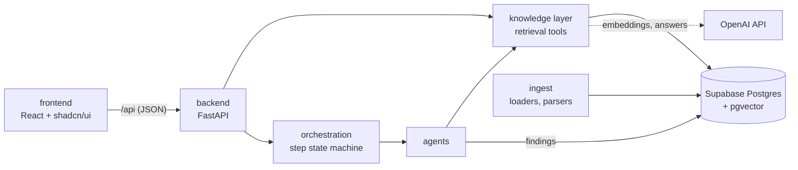

# Repository structure: frontend and backend

> Status: `building` · Last updated: 2026-10-11 (combined internal/public market evidence; see [decision 0030](../decisions/0030-feature-specific-and-public-market-evidence.md))



The browser never talks to the database or to OpenAI. The only door is the backend's `/api`.

## Layout

```
backend/
  pyproject.toml          dependencies, pytest config; `pip install -e "backend[dev]"`
  app/
    main.py               FastAPI app (CORS, routers)
    config.py             repo-root .env and data/ paths, settings; no secrets in logs
    auth/                 password hashing, users and sessions, the admin script (`python -m app.auth.manage`)
    api/                  HTTP layer: health, evidence search / counts / cite / filters, response schemas
    knowledge/            retrieval tools every agent uses; each hit carries a citation
    agents/               LLM-backed agents (Market & Trend today)
    orchestration/        agent catalog, orchestrator (decides the next agent), the LangGraph loop, step runner, chat persistence
    ingest/               loaders and parsers for PDFs and Excel files, provided or uploaded
    deploy/               repository-root Vercel build, produces public/ from frontend/dist
  tests/                  pytest; no database or OpenAI key needed
frontend/                 Gabriel's PM workspace (npm, Vite + React + TypeScript), see frontend/README.md
  src/App.tsx                shell: sign-in gate, sidebar, hash navigation between workspace views
  src/features/research/     live research: conversations and the orchestrator's decisions, agent results and final result, read-only (calls /api)
  src/features/library/      live sources view in tabs: source graph, files and upload, websites, coverage matrix (calls /api)
  src/features/evidence/     live evidence search with exact counts (calls /api)
  src/features/market-impact/ optional-feature map with internal/public evidence and explicit share scenarios
  src/components/ui/         shadcn/ui components used by the live views, restyled with BMW tokens
  src/lib/api.ts             the only place the frontend talks to the backend; src/types/api.ts mirrors the schemas
supabase/migrations/      schema, applied in filename order
docs/                     architecture, decisions, requirements
skills/                   agent skills (database setup, scripts)
data/                     provided BMW files, gitignored
Makefile  .env.example    common tasks and the environment template (one .env at the repo root)
pyproject.toml           Vercel deployment adapter and local backend package source
requirements.txt         installs backend/ with its runtime dependencies
vercel.json              root full-stack build and function settings
public/                  generated CDN frontend build, gitignored
```

## Rules

- **Dependencies point inward.** `api` calls `knowledge` and `orchestration`; `agents` call `knowledge`;
  `knowledge` talks to the database. `api` never writes SQL, and nothing imports from `api`.
- **Python imports are `app.<package>`**, scripts run as `python -m app.<package>.<module>`, so paths
  never depend on the working directory.
- **One source for response shapes:** `backend/app/api/schemas.py`, mirrored by `frontend/src/types/api.ts`.
  Change both together.
- **Every API result that states a fact carries a citation** (file, location, verbatim quote).
- **The frontend never touches the database.** Every live view calls `/api`; all SQL is in the backend. There is no
  demo data in the frontend.
- **UI follows `design.md` and decision 0021:** BMW tokens, rounded components, soft shadows and
  the approved Inter substitute font, no dark theme. Components keep labels above fields and show loading, empty and
  error states.
- **Tests:** `make test` for the backend (the API tests replace the knowledge tools with fakes). The
  frontend is checked by `make build` (type-check and bundle), `make lint`, and `npm test`
  from `frontend/` (desktop/mobile Playwright workflows and automated accessibility checks).

## API today

| Endpoint | Returns |
|---|---|
| `POST /api/auth/login` | public: email and password in, a session token out; every failure reads the same, five wrong passwords lock the account for 15 minutes |
| `GET /api/auth/me`, `POST /api/auth/logout` | who am I; revoke this session |
| `GET /api/health` | database and OpenAI-key status (never connection details) |
| `GET /api/evidence/search?q=&source=feedback\|docs&line=&market=&domain=&polarity=&powertrain=&k=` | cited hits, hybrid vector and keyword search |
| `GET /api/evidence/stats?group_by=&line=&market=...` | exact counts and their total |
| `GET /api/evidence/filters` | the values the UI offers as filters |
| `GET /api/market-impact/options?line=` | up to 200 cited equipment options that are optional on at least one variant, with a truncation flag |
| `POST /api/market-impact/assessment` | local, deduplicated feature-passage signals with internal citations for one line/feature |
| `POST /api/market-impact/web-assessment` | independent public-only web research with fetched page excerpts, geography checks and visible gaps |
| `GET /api/evidence/{kind}/{id}` | the citation for one stored row |
| `GET /api/sources` | every loaded source file with what was extracted from it (comments, passages, options, study cells, sales rows) |
| `POST /api/sources?filename=&line=&replace=` | upload one PDF or Excel file as the raw request body; it is stored by the loaders in `app/ingest` and the answer reports what was stored and skipped ([decision 0023](../decisions/0023-file-upload-reuses-the-loaders.md)) |
| `POST /api/sources/web` | fetch one public web page (`url`, optional `line`, `market`, `trust_tier`, `replace`) and store its text as cited passages ([decision 0024](../decisions/0024-websites-as-sources-and-tabbed-sources-view.md)) |
| `DELETE /api/sources/{id}` | remove a stored website and its passages; files are refused |
| `GET /api/sources/graph` | rows each source holds per vehicle line and market, for the graph view |
| `GET /api/sources/web-research` | websites the web agents read during runs, from the stored step outputs |
| `GET /api/evidence/coverage` | comments, study cells and 2025 sales per vehicle line and market, so gaps are visible |
| `GET /api/agents` | the agent catalog in pipeline order and which agents exist yet |
| `GET, POST /api/conversations` | list, or create (optionally with a first request) |
| `GET, PATCH /api/conversations/{id}` | the thread (messages and runs with steps), or rename / archive |
| `POST /api/conversations/{id}/messages` | a PM request: stored at once; the orchestrator then calls agents on its own in the background (409 while the previous request is still running) |

Everything except `/api/health` and `/api/auth/login` needs `Authorization: Bearer <token>`; without it the answer is a
uniform 401 and no database connection is opened. Bad parameters give 422, unknown rows 404, and an unreachable database 503 with no internals in the
message. Interactive docs are served at `/docs`.

## Not built yet

- A separate worker or queue for runs (they execute in the API process; a restart resumes them, decision 0019).
- Successor target editing and scheduled reports. Requirement, tracking and dossier views are implemented.
- A Docker setup and CI.

## Frontend delivery

The UI includes live research, models, requirements, tracking, dossiers, evidence and sources documented in
[the frontend guide](../../frontend/README.md). It holds no fixtures and needs `/api` on its origin; Vite proxies it
in development. Dependencies use the npm lockfile; the Makefile installs with `npm ci`.

## Model overviews (decision 0025)

`backend/app/comparisons/` contains local catalog parsing, public-source discovery/scraping,
quote validation and the context-loaded chat adapter. `backend/app/knowledge/models.py` owns
model evidence access and deterministic cohort median/mean calculations. `backend/app/api/models.py`
exposes the authenticated `/api/models` endpoints. `frontend/src/features/models/` renders the
compact model/variant/market comparison workspace, diagrams, source validation controls and
the existing chat. `20261016_model_comparisons.sql` adds the persistence and chat bindings.
All comparisons are calculated by the server against Supabase; no database keys or business
fixtures are shipped to the frontend.

## Vercel deployment (decision 0027)

Deploy from the repository root. The root pyproject.toml points Vercel to the existing FastAPI
deployment adapter and installs the locally sourced backend package (requirements.txt supports pip).
`app.deploy.build` runs the
frontend lockfile install and production build, then prepares public/ for CDN delivery.
The adapter registers the generated frontend with FastAPI for explicit CDN promotion. Protected
API routes take priority. Hash navigation requires no SPA fallback, preserving missing-file and
disabled-documentation errors. A frontend-only dependency returns 404 when CDN promotion omits
the static directory from the function bundle; API routes retain their normal handlers.
The API shares that origin and uses
encrypted server-only Supabase/OpenAI configuration.
The root ignore/configuration files omit credentials, BMW files and development artifacts.
Deployment runs no migrations or user-management commands. The local `make dev` workflow remains.

### Market evidence and share scenarios

Catalog selection automatically starts independent internal and public research requests. Custom feature text uses
Assess feature. Both endpoints are authenticated and read catalog names through knowledge tools. Internal feedback
stays local: feature-specific passages are classified conservatively, repeated text is counted once, and broad row
polarity does not determine option impact. Source sample limits and ambiguous matches remain visible.

Public search receives generic public feature terms only. Its candidate pages are fetched and checked; accepted
citations are actual short page excerpts, not unverified generated search summaries. Manufacturer availability,
shopping-site claims, social anecdotes and unverified geography cannot color a market. The source date, type, scope,
and classification reason accompany every public citation. An unavailable public provider does not erase internal
results; the view exposes Retry research. No supported public term for a catalog label is an explicit gap.

Green means a potential feature benefit/demand signal, red an implementation or acceptance risk, and mixed means
both kinds of evidence exist. Internal and external signals are combined without count weighting or averaging away
conflicts. Color is never a validated share forecast. Manual percentage-point scenarios override a market color;
baseline plus change must stay within 0–100%. Exclusion shows zero feature effect while retaining evidence. Numeric
share values are only explicit PM assumptions. Export includes internal assessment, public citations, and scenarios.
Responses are cached in view memory by line/feature; public research also has a bounded 15-minute backend cache.
Old requests are aborted and late replies discarded. There is no schema change or new stored customer data.

Natural Earth geometry is bundled locally and maps schematic regions: Europe excluding Russia, China, United
States and rest of world. Countries share a region signal; the map is not a country-level forecast or an EU
membership map. Equivalent keyboard-accessible market buttons and text summaries communicate the same result.
See [decision 0030](../decisions/0030-feature-specific-and-public-market-evidence.md).

Verified feature mentions without directional market support appear separately as general web context, with
short page excerpts and source links. They never color a market or fill its evidence gap.
