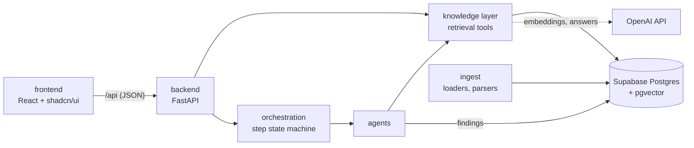

# Repository structure: frontend and backend

> Status: `building` · Last updated: 2026-10-10 (PM workspace and demo/live evidence boundary; see [decision 0011](../decisions/0011-local-demo-frontend-and-vercel.md))



The browser never talks to the database or to OpenAI. The only door is the backend's `/api`.

## Layout

```
backend/
  pyproject.toml          dependencies, pytest config; `pip install -e "backend[dev]"`
  app/
    main.py               FastAPI app (CORS, routers)
    config.py             repo-root .env and data/ paths, settings; no secrets in logs
    api/                  HTTP layer: health, evidence search / counts / cite / filters, response schemas
    knowledge/            retrieval tools every agent uses; each hit carries a citation
    agents/               LLM-backed agents (Market & Trend today)
    orchestration/        agent catalog, planner, chat and plan persistence, step state machine
    ingest/               loaders and parsers for the provided PDFs and Excel files
  tests/                  pytest; no database or OpenAI key needed
frontend/
  src/
    App.tsx, data.ts      PM workspace shell, typed fixtures, local persistence and actions
    components/           overview, requirements, research, evidence, reports and dialogs
    components/ui/        retained shadcn/ui components (generated, restyled with BMW tokens)
    components/layout/    app shell, backend health badge
    components/evidence/  citation block, hit card, filter select
    features/evidence/    evidence explorer (live, uses the API)
    features/chat/        earlier chat shell (retained, not the active workspace)
    lib/api.ts            typed API client
    types/api.ts          mirrors backend/app/api/schemas.py
supabase/migrations/      schema, applied in filename order
docs/                     architecture, decisions, requirements
skills/                   agent skills (database setup, scripts)
data/                     provided BMW files, gitignored
Makefile  .env.example    common tasks and the environment template (one .env at the repo root)
```

## Rules

- **Dependencies point inward.** `api` calls `knowledge` and `orchestration`; `agents` call `knowledge`;
  `knowledge` talks to the database. `api` never writes SQL, and nothing imports from `api`.
- **Python imports are `app.<package>`**, scripts run as `python -m app.<package>.<module>`, so paths
  never depend on the working directory.
- **One source for response shapes:** `backend/app/api/schemas.py`, mirrored by `frontend/src/types/api.ts`.
  Change both together.
- **Every API result that states a fact carries a citation** (file, location, verbatim quote).
- **UI follows `design.md`:** BMW tokens, rectangular components, no shadows, Inter 300/700 as the
  approved substitute font, no dark theme. Components keep labels above fields and show loading, empty and
  error states.
- **Tests:** `make test` for the backend (the API tests replace the knowledge tools with fakes). The
  frontend is checked by `make build` (type-check and bundle), `make lint`, and `npm test`
  from `frontend/` (desktop/mobile Playwright workflows and automated accessibility checks).

## API today

| Endpoint | Returns |
|---|---|
| `GET /api/health` | database and OpenAI-key status (never connection details) |
| `GET /api/evidence/search?q=&source=feedback\|docs&line=&market=&domain=&polarity=&powertrain=&k=` | cited hits, hybrid vector and keyword search |
| `GET /api/evidence/stats?group_by=&line=&market=...` | exact counts and their total |
| `GET /api/evidence/filters` | the values the UI offers as filters |
| `GET /api/evidence/{kind}/{id}` | the citation for one stored row |
| `GET /api/agents` | the agent catalog in pipeline order and which agents exist yet |
| `GET, POST /api/conversations` | list, or create (optionally with a first request) |
| `GET, PATCH /api/conversations/{id}` | the thread (messages and runs with steps), or rename / archive |
| `POST /api/conversations/{id}/messages` | a PM request: the orchestrator plans and stores `planned` steps |
| `PUT /api/runs/{id}/plan` | the PM edits the plan before any agent starts |

Bad parameters give 422, unknown rows 404, and an unreachable database 503 with no internals in the
message. Interactive docs are served at `/docs`.

## Not built yet

- Starting the plan: accepting the plan, running the first step, and the PM actions on a step card (accept,
  edit, retry, reject). The chat API and the planner exist; the agents behind the steps and the runner do not.
- Chat in the frontend: the Chat screen still shows its empty state.
- Authentication: the API is open, which is fine for a local demo and must change before it is exposed.
- A Docker setup and CI.

## Frontend delivery

The active UI is the five-view PM workspace documented in [the frontend guide](../../frontend/README.md).
Its portfolio, research, targets, and reports use explicitly illustrative fixtures and browser
local storage. The retained API Evidence browser is available from Evidence library during
local development, or with `VITE_LIVE_EVIDENCE=true` when the deployed origin serves `/api`.
The static Vercel demo keeps live access disabled. Vite retains the backend proxy and `@` alias.
Dependencies use the npm lockfile; the Makefile and Vercel install with `npm ci`.
