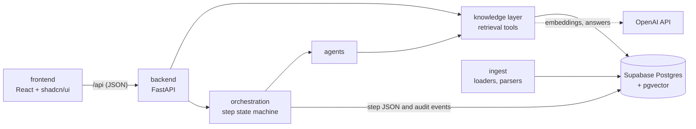

# Repository structure: frontend and backend

> Status: `building` · Last updated: 2026-10-10 (database workspace; [decision 0023](../decisions/0023-database-backed-workspace.md))



The browser never talks to the database or to OpenAI. The only door is the backend's `/api`.

## Layout

```
backend/
  pyproject.toml          dependencies, pytest config; `pip install -e "backend[dev]"`
  app/
    main.py               FastAPI app (CORS, routers)
    config.py             repo-root .env and data/ paths, settings; no secrets in logs
    auth/                 password hashing, users and sessions, the admin script (`python -m app.auth.manage`)
    api/                  HTTP layer: auth, evidence, chat, workspace reads/reviews, response schemas
    knowledge/            agent retrieval tools and database-backed workspace/library repositories
    agents/               all roster modules; model-backed extraction plus deterministic scoring/audit
    orchestration/        catalog, planner, persistence, Critic-gated step runner and state machine
    ingest/               loaders and parsers for the provided PDFs and Excel files
  tests/                  fixture tests plus optional transaction-rolled-back database integration tests
frontend/                 Gabriel's PM workspace (npm, Vite + React + TypeScript), see frontend/README.md
  src/App.tsx, components/   the five authenticated views over backend snapshots and stored results
  src/features/research/     live research: conversations, planning, execution, polling and PM review actions (calls /api)
  src/features/library/      live evidence library: loaded sources and coverage matrix (calls /api)
  src/features/evidence/     live evidence search with exact counts (calls /api)
  src/components/ui/         shadcn/ui components used by the live views, restyled with BMW tokens
  src/lib/api.ts             the only place the frontend talks to the backend; src/types/api.ts mirrors the schemas
supabase/migrations/      schema, applied in filename order
docs/                     architecture, decisions, requirements
skills/                   agent skills (database setup, scripts)
data/                     provided BMW files, gitignored
Makefile  .env.example    common tasks and the environment template (one .env at the repo root)
```

## Rules

- **Dependencies point inward.** `api` calls `knowledge` and `orchestration`; `agents` call `knowledge`;
  `knowledge` talks to the database. `api` never writes SQL, and nothing imports from `api`.
- **Python imports are `app.<package>`**, scripts run as `python -m app.<package>.<module>`, so paths
  never depend on the working directory.
- **One source for response shapes:** `backend/app/api/schemas.py`, mirrored by `frontend/src/types/api.ts`.
  Change both together.
- **Evidence rows carry source references** (file/URL and locator). Raw search hits include the stored quote;
  requirement citations contain the persisted finding text or source snapshot. Aggregates state their scope.
- **The frontend never touches the database.** Every business view calls `/api`; all SQL is in the backend.
  No fixture values or browser-only business state are generated. Production needs an API on the same origin.
- **UI follows `design.md`:** BMW tokens, rectangular components, no shadows, Inter 300/700 as the
  approved substitute font, no dark theme. Components keep labels above fields and show loading, empty and
  error states.
- **Tests:** `make test` for the backend (the API tests replace the knowledge tools with fakes). The
  frontend is checked by `make build` (type-check and bundle), `make lint`, and `npm test`
  from `frontend/` (desktop/mobile Playwright workflows and automated accessibility checks).

## API today

| Endpoint | Returns |
|---|---|
| `POST /api/auth/login` | public: email and password in, a session token out; every failure reads the same, five wrong passwords lock the account for 15 minutes |
| `GET /api/auth/me`, `POST /api/auth/logout` | who am I; revoke this session |
| `GET /api/health` | database and OpenAI-key status (never connection details) |
| `GET /api/evidence/search?q=&source=feedback\|docs&line=&market=&domain=&polarity=&powertrain=&k=` | cited hits, hybrid vector and keyword search |
| `GET /api/evidence/stats?group_by=&line=&market=...` | exact counts and their total |
| `GET /api/evidence/filters` | the values the UI offers as filters |
| `GET /api/evidence/{kind}/{id}` | the citation for one stored row |
| `GET /api/sources` | every loaded source file with what was extracted from it (comments, passages, options, study cells, sales rows) |
| `GET /api/evidence/coverage` | comments, study cells and newest recorded-year sales per vehicle line and market, so gaps are visible |
| `GET /api/workspace/config` | active vehicle-line/market keys and labels from ontology |
| `GET /api/workspace?line=&market=` | scoped evidence counts, sales/forecasts, catalog/study rows, backlog/latest scores, accepted contributions and audit events |
| `PATCH /api/requirements/{id}/status` | status review with expected previous status, required reason and audit event |
| `GET /api/agents` | the agent catalog in pipeline order and which agents exist yet |
| `GET, POST /api/conversations` | list, or create (optionally with a first request) |
| `GET, PATCH /api/conversations/{id}` | the thread (messages and runs with steps), or rename / archive |
| `POST /api/conversations/{id}/messages` | a PM request: the orchestrator plans and stores `planned` steps |
| `PUT /api/runs/{id}/plan` | the PM edits the plan before any agent starts |
| `POST /api/runs/{id}/start` | the PM confirms the plan; the first agent starts in the background |
| `POST /api/steps/{id}/accept`, `retry`, `reject`, `edit` | the PM's four actions on a step in review; accept starts the next agent |

Everything except `/api/health` and `/api/auth/login` needs `Authorization: Bearer <token>`; without it the answer is a
uniform 401 and no database connection is opened. Bad parameters give 422, unknown rows 404, and an
unreachable database 503 with no internals in the
message. Interactive docs are served at `/docs`.

## Not built yet

- Persisting accepted outputs into the finding/requirement/score backlog and recovering interrupted background steps.
- Successor targets, persisted scoring-weight configuration and a PM input ingestion API.
- A Docker setup and CI.

## Frontend delivery

The active five-view PM workspace is documented in [the frontend guide](../../frontend/README.md).
Sign-in protects every view. Scope keys and labels come from ontology; business records come from
`/api/workspace`, evidence/library endpoints and the real chat runner. Missing backlog rows, scores,
targets and accepted results are displayed as missing. There is no demo mode or local business-data store.
Accepted step output is visible in Overview and Reports without being misrepresented as a backlog row.
Production must serve `/api`; Vite retains its backend proxy and `@` alias for local work.
Dependencies use the npm lockfile; the Makefile and Vercel install with `npm ci`.
