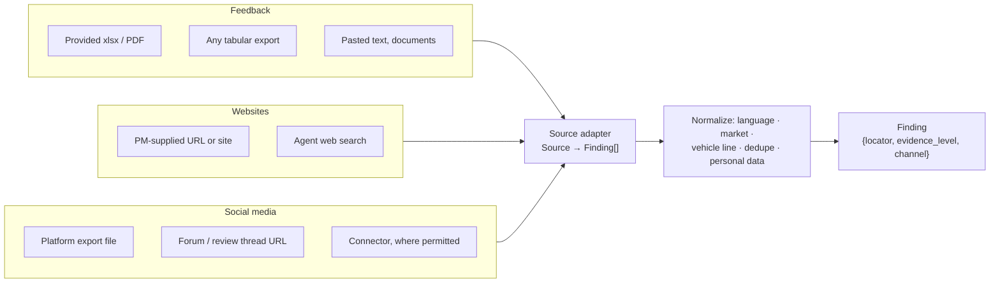

# Inputs & ingestion

> Status: `draft` · Last updated: 2026-10-10

Everything the system knows starts as a source somebody or something put in. The aim is that a PM
never has to reshape evidence to fit the tool: a spreadsheet with unfamiliar columns, a pasted
email, a link to a comparison test and an export of social media posts all end up as the same
thing — a `Finding` with a locator, a market, and an honest evidence level.

Derived from [`03-ingestion.md`](../architecture/03-ingestion.md) and the "new source = one
adapter" rule in [`08-scaling-and-config.md`](../architecture/08-scaling-and-config.md); the three
input families below extend both.

## Common to every input

| ID | Requirement | Prio | Origin |
|---|---|---|---|
| FR-IN-01 | Accept every input through one adapter contract (`Source → Finding[]`), so adding an input type changes nothing in clustering, drafting or scoring. | M | [08](../architecture/08-scaling-and-config.md#new-source--one-adapter) |
| FR-IN-02 | Record for every source: input family (feedback / website / social media / internal data), channel or platform, origin (uploaded, pasted, PM-supplied link, agent search, connector), language, retrieval time, and who added it. | M | new |
| FR-IN-03 | Give every finding a locator precise enough to open the original spot: sheet + row + column, page, URL + retrieval date, or post ID. | M | [03](../architecture/03-ingestion.md) |
| FR-IN-04 | Assign every finding an evidence level on ingest — by extraction method for files, by source-trust tier for web and social content. | M | [03](../architecture/03-ingestion.md#tier-2--semantic-narrative-text-web-content) |
| FR-IN-05 | Show a per-source ingest report: items read, findings produced, items skipped and why. A source that fails to parse is reported as failed, never silently dropped. | M | new |

## Feedback

| ID | Requirement | Prio | Origin |
|---|---|---|---|
| FR-IN-08 | Ingest the provided feedback, customer-study, sales-volume and option-list files without manual preparation. | M | [03](../architecture/03-ingestion.md) |
| FR-IN-09 | Ingest a tabular feedback file with unknown columns (xlsx, csv): propose a mapping of its columns to text, rating, market, vehicle line, date and sample size, and let the PM confirm or correct the mapping before findings are created. | S | new |
| FR-IN-10 | Accept free text pasted by the PM (an email, interview notes, a dealer report) and document uploads (PDF, Word), and split them into individual findings. | S | new |
| FR-IN-11 | Parse tables deterministically and narrative text semantically, and keep the two distinguishable by evidence level. | M | [03](../architecture/03-ingestion.md), [ADR 0001](../decisions/0001-two-tier-pdf-ingestion.md) |

**FR-IN-09** — a saved mapping is reused when a file with the same column layout arrives again.
**FR-IN-10** — pasted text has no external locator; the stored text itself plus the paragraph index
is the locator, and the PM who pasted it is recorded as the origin.

## Websites

| ID | Requirement | Prio | Origin |
|---|---|---|---|
| FR-IN-06 | Let the PM submit a single URL and have that page ingested into the current scope. | M | new |
| FR-IN-07 | Let the PM submit a site or a list of URLs with a page limit, and ingest the pages within that limit. | S | new |
| FR-IN-14 | Let agents find web sources themselves by search, within the run's vehicle line and market. | M | [01](../architecture/01-agents.md) |
| FR-IN-15 | Store a snapshot of the cited passage of every web and social source at retrieval time, so a citation survives the page changing or disappearing. | S | new |
| FR-IN-16 | Respect robots.txt, and mark content behind a paywall or login as not retrievable rather than citing a teaser as if it were the article. | M | [10](../architecture/10-competitor-benchmarking.md#5--evidence-collection-scrape-per-shortlisted-rival), [02](../architecture/02-orchestration-and-human-in-the-loop.md) |

## Social media

| ID | Requirement | Prio | Origin |
|---|---|---|---|
| FR-IN-12 | Ingest social media content from at least two routes: an export file (csv/json of posts and comments) and a public thread or review-page URL. | M | new |
| FR-IN-13 | Keep reach signals (likes, replies, shares, star rating) on a finding as separate fields. Reach is never stored or displayed as a sample size. | M | new |
| FR-IN-17 | Remove or mask personal data — usernames, handles, profile links, contact details — before a finding is stored or shown. The locator still resolves to the post. | M | new |
| FR-IN-18 | Filter out content that is not a customer statement about the vehicle — advertising, spam, bot-like repetition, off-topic replies — and count what was filtered in the ingest report. | S | new |
| FR-IN-19 | Ingest directly from a platform through a connector only where the platform's terms permit it; the set of enabled connectors is configuration. | C | new |

**FR-IN-12** — the export route is the demo path: it needs no direct platform access. Permission to use the
exported material depends on its source. **FR-IN-13** — a post with 4,000 likes is one voice with reach, not
4,000
respondents; prioritization (`FR-PR-02`) treats the two differently.

## Normalization

| ID | Requirement | Prio | Origin |
|---|---|---|---|
| FR-IN-20 | Detect the language of each item, keep the original text, and store a translation into the working language next to it. | S | new |
| FR-IN-21 | Attribute each finding to a vehicle line and market. Where the source does not make that clear, mark it "unassigned" for the PM to resolve rather than guessing. | M | new |
| FR-IN-22 | Detect the same item arriving twice — re-uploaded file, re-crawled page, a post quoted in another post — and keep one finding. | S | new |
| FR-IN-23 | Maintain an editable trust tier per web domain and social platform (official > trade press > forum/social); unknown domains start at the lowest tier. | M | [03](../architecture/03-ingestion.md), [10](../architecture/10-competitor-benchmarking.md) |
| FR-IN-24 | Let the PM re-run ingestion for a source on demand, and schedule recurring re-ingestion for sources that change (websites, social feeds). | S | [05](../architecture/05-requirement-lifecycle.md) |

## Out of this doc

Which agent uses which findings is in [`02-analysis-and-structuring.md`](02-analysis-and-structuring.md).
The legal assessment of scraping a specific platform is not a functional requirement; `FR-IN-16`
and `FR-IN-19` only fix how the system behaves once that assessment exists.
